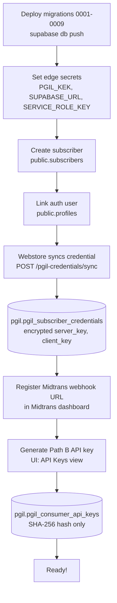
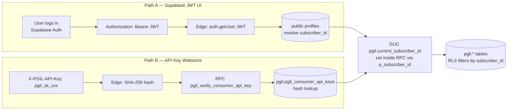
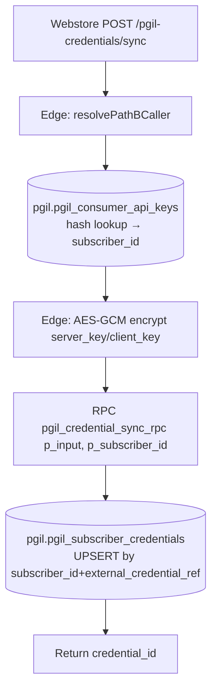
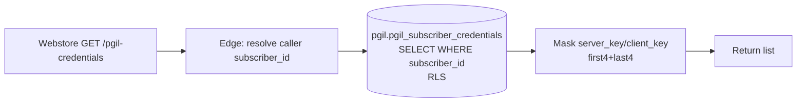
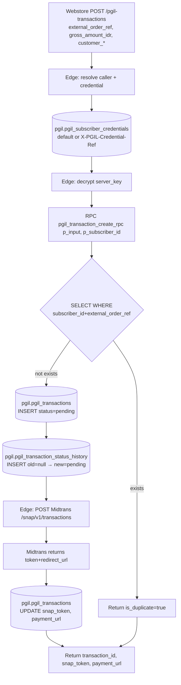
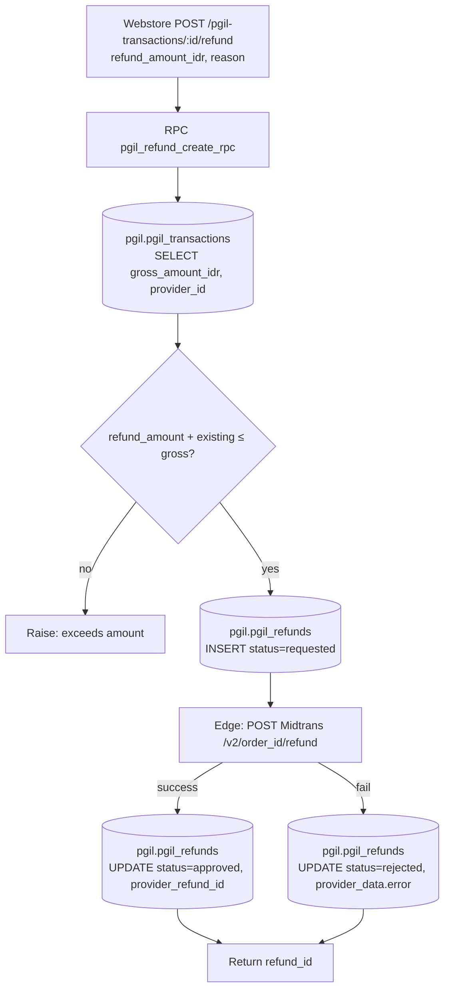
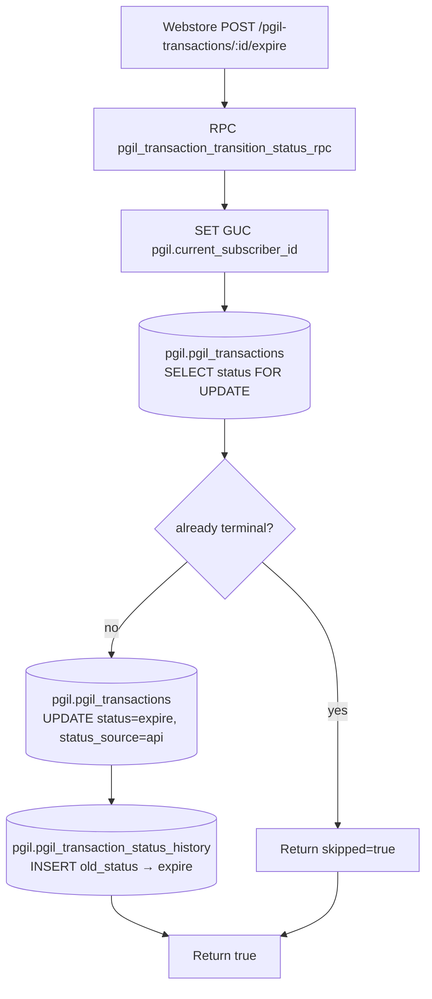
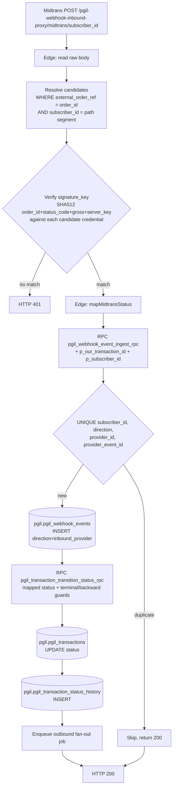
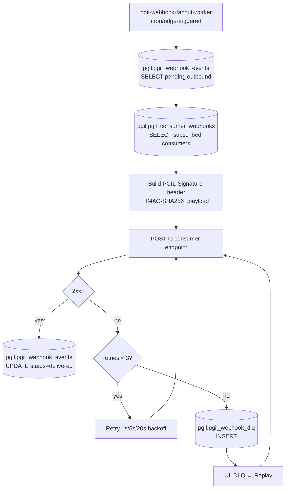
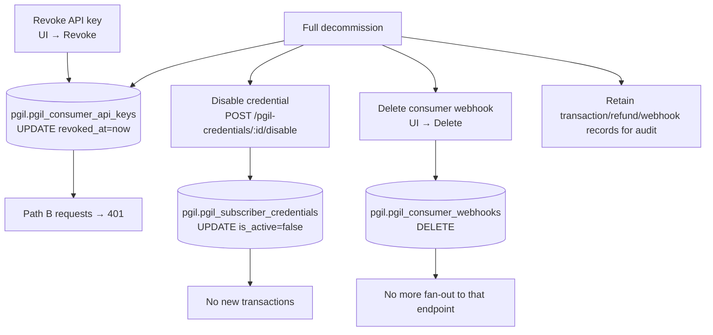

# PaymentGatewayIL (PGIL) — API Workflows & Integration Guide

- **Status**: Ready for staging (2026-10-15). Backend + frontend tested end-to-end locally.
- **Audience**: (A) Platform admin onboarding a subscriber to PGIL, (B) Webstore backend engineer integrating via Path B API key.
- **Prerequisites**: Auth tenancy design doc, webhook spec doc.

---

## 1. Scope

PGIL is a **provider-abstraction layer for payment gateways**, Phase 1 = Midtrans (Snap only).

- Unified `pgil_transactions` table (provider-agnostic).
- Snap popup/iframe flow (PCI SAQ A).
- Full + partial refunds.
- Dual-path auth: Path A (Supabase JWT for UI), Path B (`X-PGIL-API-Key` SHA-256 for Webstore).
- Webstore owns Midtrans credentials (syncs to PGIL); PGIL UI is **read-only**.
- Inbound webhook proxy + outbound fan-out to Webstore (HMAC-SHA256, DLQ, replay).
- Always `subscriber_id` (never `tenant_id`); reuses `public.subscribers` + `public.profiles`.
- All PGIL tables live in `pgil` schema; private helpers in `pgil_private`.

---

## 2. Midtrans APIs Used

| PGIL Operation | Midtrans Endpoint | Method |
|:---|:---|:---|
| Create Snap transaction | `https://app.{sandbox,}.midtrans.com/snap/v1/transactions` | POST |
| Get transaction status | `https://api.{sandbox,}.midtrans.com/v2/{order_id}/status` | GET |
| Refund | `https://api.{sandbox,}.midtrans.com/v2/{order_id}/refund` | POST |
| Test connection | `GET /v2/pgil-test-conn-{ts}/status` | GET |
| Inbound webhook | Midtrans → PGIL | POST |

Auth: HTTP Basic Auth with `server_key` (decrypted edge-side AES-GCM).

---

## 3. Onboarding Flow



### 3.1 Deploy + Secrets
- `supabase db push` (applies 0001–0009).
- Set `PGIL_KEK` (32-byte, `openssl rand -hex 32`), `SUPABASE_URL`, `SUPABASE_SERVICE_ROLE_KEY`.

### 3.2 Subscriber + Profile
PGIL reuses `public.subscribers` and `public.profiles` (shared with ThirdPLIL).

### 3.3 Credential Sync (Webstore → PGIL)
```http
POST /functions/v1/pgil-credentials/sync
X-PGIL-API-Key: pgil_sk_sandbox_xxxxxxxx
```
```json
{ "external_credential_ref": "midtrans-sandbox-main", "provider_slug": "midtrans",
  "is_sandbox": true, "server_key": "SB-Mid-server-xxx", "client_key": "SB-Mid-client-xxx",
  "is_default": true }
```
Upserts by `(subscriber_id, external_credential_ref)`. Keys encrypted with AES-GCM.

### 3.4 Midtrans Webhook URL
```
POST https://<project-ref>.supabase.co/functions/v1/pgil-webhook-inbound-proxy/midtrans/<subscriber_id>
```
`<subscriber_id>` is the numeric `public.subscribers.subscriber_id`, passed as a **path segment**
(not a query string). PGIL injects this full URL automatically on every Snap create call via the
Midtrans `X-Override-Notification` header, so **no manual Midtrans dashboard configuration is
required**. If a merchant's Midtrans account has not enabled the override feature, the same URL can
be pasted into Midtrans dashboard → Settings → Configuration instead.

The URL carries no secret: requests are authenticated by Midtrans' native `signature_key`
(SHA512 of `order_id + status_code + gross_amount + server_key`). The subscriber id only selects
which credential's `server_key` the signature is verified against. The `order_id` sent to Midtrans
is always the consumer's `external_order_ref` — PGIL never rewrites it. When the path segment is
absent (e.g. an un-migrated dashboard URL), the proxy falls back to resolving the transaction by
`external_order_ref` and testing the signature against each candidate credential.

### 3.5 Generate Path B API Key
UI → API Keys → Generate. Raw key shown **once** (`pgil_sk_sandbox_...` or `pgil_sk_live_...`).

---

## 4. Auth Workflow



### 4.1 `p_subscriber_id` pattern
GUC doesn't persist across PostgREST RPC calls (connection pooling). All 6 RPCs accept `p_subscriber_id bigint DEFAULT NULL` and set the GUC internally:
```sql
if p_subscriber_id is not null then
  perform set_config('pgil.current_subscriber_id', p_subscriber_id::text, false);
end if;
v_subscriber_id := pgil_private.current_user_subscriber_id();
```

### 4.2 Outbound webhook signature
```
PGIL-Signature: t=<unix_ms>,v1=<hex_hmac_sha256(t.payload, consumer_secret)>
```
64-hex consumer secret shown once at registration. Verify with constant-time compare + ±5 min skew.

---

## 5. Consumer-Facing API Endpoint Workflows

Base: `https://<project-ref>.supabase.co/functions/v1`

All responses: `StandardEnvelope<T>` = `{ success, data, errors, is_duplicate, warnings }`.

### 5.1 `POST /pgil-credentials/sync` — Sync Credential



### 5.2 `GET /pgil-credentials` — List Credentials



### 5.3 `POST /pgil-transactions` — Create Transaction (Snap)



**Idempotency**: `external_order_ref` is the dedup key. Retry-safe.

### 5.4 `POST /pgil-transactions/:id/refund` — Refund



### 5.5 `POST /pgil-transactions/:id/expire` — Expire



### 5.6 `GET /pgil-transactions` & `GET /pgil-transactions/:id` — List / Detail

Paginated list or full detail + status history + refunds, filtered by `subscriber_id` via RLS.

---

## 6. Webhook Workflow

### 6.1 Inbound: Midtrans → PGIL



When the `subscriber_id` path segment is absent, step R widens to every transaction sharing that
`external_order_ref`; the signature check in step C then picks the correct subscriber (only the
owner's `server_key` can produce a valid `signature_key`).

### 6.2 Outbound: PGIL → Webstore (Fan-Out)



### 6.3 Event Types
`transaction.created`, `transaction.status_changed`, `transaction.refunded`, `transaction.expired`.

---

## 7. Offboarding Flow



---

## 8. Staging Readiness Checklist

| Item | Status |
|:---|:---|
| Migrations 0001–0009 applied | ✅ |
| All 6 RPCs have `p_subscriber_id` + set GUC | ✅ |
| Schema grants (`pgil`, `pgil_private`) | ✅ |
| `pgcrypto` `search_path` fix | ✅ |
| 8 edge functions | ✅ (tested locally) |
| `PGIL_KEK` secret | ⚠️ Set in staging dashboard |
| Frontend PGIL views | ✅ (tsc + build clean) |
| Real Midtrans sandbox credential | ⚠️ Run sync with real key |
| Midtrans webhook URL | ⚠️ Configure in Midtrans dashboard |
