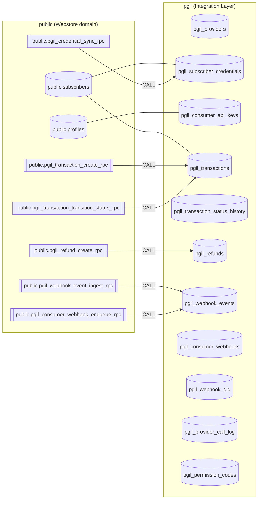
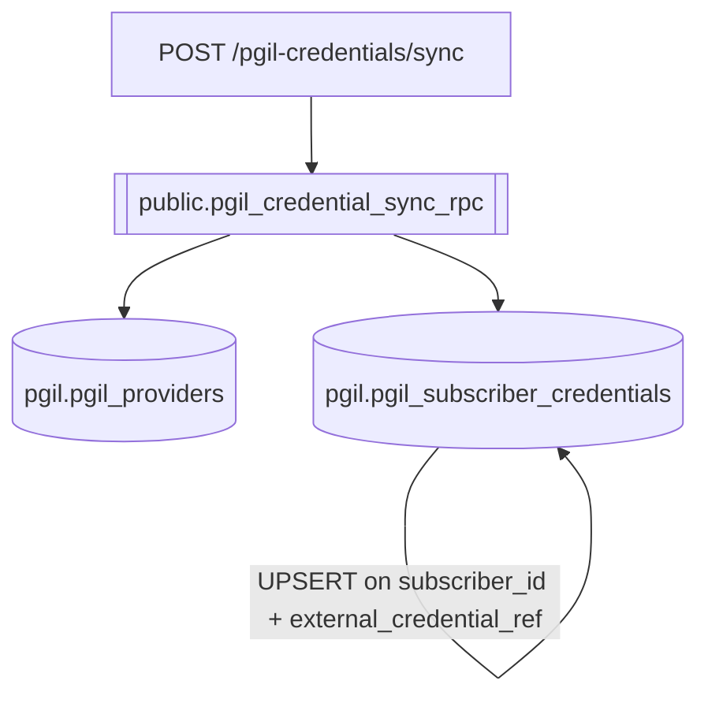
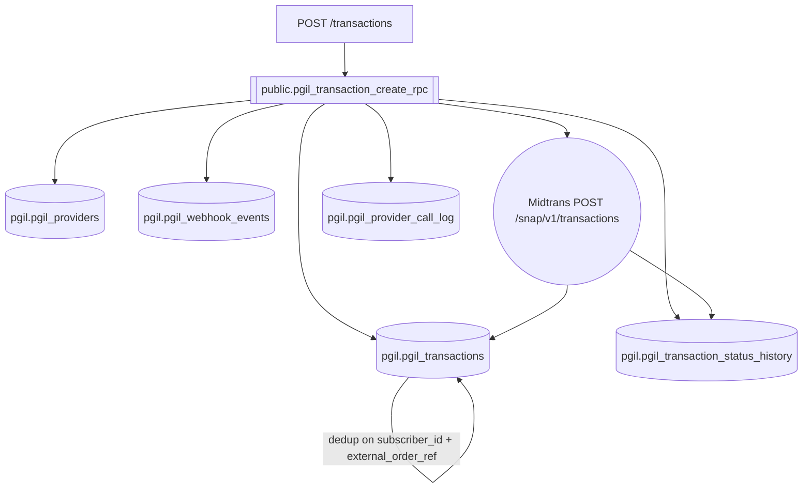
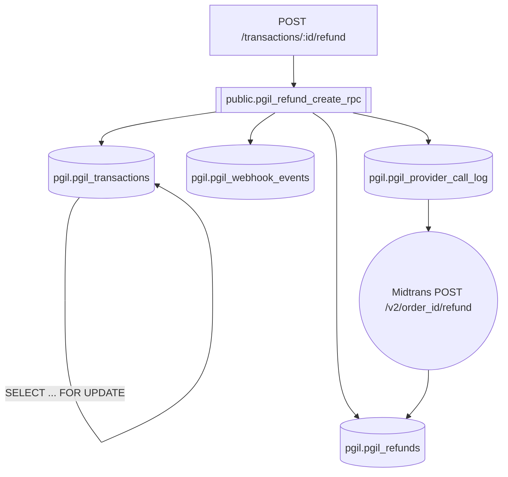
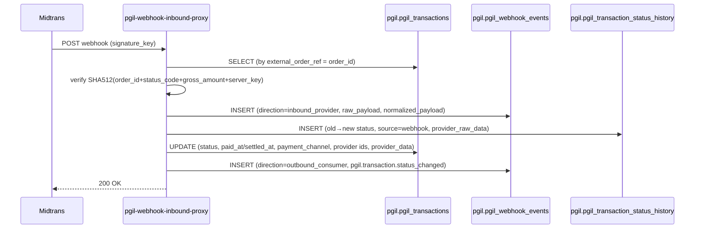
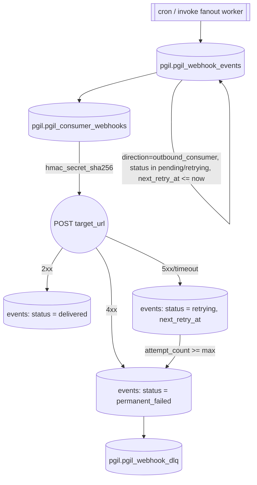

# PaymentGatewayIL (PGIL) — Table Schema & Data Lifecycle

- **Status**: Ready for staging. PGIL migrations 0001–0009 applied. `pgil` schema active; private helpers in `pgil_private`.
- **Source of truth**: Authored from live DB introspection of the local `supabase_db_InezWebstoreSupabase` instance (authoritative column names, types, nullability, defaults, constraints, enums, indexes).
- **Audience**: Backend engineers and DBAs maintaining PGIL; integration engineers needing to know exactly which tables each endpoint mutates.
- **Companions**: [05-api-workflows.md](file:///home/calvin/WebstoreGroup/WebstoreSupabase/supabase/docs/PaymentGatewayIL/05-api-workflows.md), [02-data-model.md](file:///home/calvin/WebstoreGroup/WebstoreSupabase/supabase/docs/PaymentGatewayIL/02-data-model.md), [04-webhook-spec.md](file:///home/calvin/WebstoreGroup/WebstoreSupabase/supabase/docs/PaymentGatewayIL/04-webhook-spec.md), [07-auth-tenancy-design.md](file:///home/calvin/WebstoreGroup/WebstoreSupabase/supabase/docs/PaymentGatewayIL/07-auth-tenancy-design.md).

---

## 0. Schema Map

- `pgil` — **all** PGIL tables + the real RPC implementations.
- `pgil_private` — internal helpers only (no PostgREST exposure): tenancy resolvers, permission context, API-key verifier, credential default setter, webhook enqueue, FSM guards.
- `public` — thin `SECURITY INVOKER` **alias wrappers** for PostgREST-exposed RPCs (`public.pgil_*_rpc`). PostgREST exposes only the `public` schema.
- `public.subscribers` / `public.profiles` — shared tenancy tables (owned by Webstore). `subscriber_id` is the tenancy boundary everywhere.
- `extensions` — `pgcrypto` (`digest()`).



---

## 1. Tables

### 1.1 Registry & Provider Config

#### `pgil.pgil_providers`
Provider registry. Phase 1 = Midtrans (Snap).

| Column | Type | Null | Default | Notes |
|:---|:---|:---|:---|:---|
| `provider_id` | bigint | NOT NULL | `nextval` | PK |
| `slug` | `pgil_provider_slug` | NOT NULL | — | UNIQUE (`pgil_providers_slug_key`) |
| `display_name` | text | NOT NULL | — | |
| `base_url_sandbox` | text | NOT NULL | — | `api.sandbox.midtrans.com` |
| `base_url_production` | text | NOT NULL | — | `api.midtrans.com` |
| `snap_url_sandbox` | text | NOT NULL | — | `app.sandbox.midtrans.com` |
| `snap_url_production` | text | NOT NULL | — | `app.midtrans.com` |
| `docs_url` | text | NULL | — | |
| `enabled` | boolean | NOT NULL | `true` | |
| `capabilities` | jsonb | NOT NULL | `'{}'` | |
| `created_at` / `updated_at` | timestamptz | NOT NULL | `now()` | |

#### `pgil.pgil_permission_codes`
Permission catalog for Path A UI RBAC.

| Column | Type | Null | Default | Notes |
|:---|:---|:---|:---|:---|
| `code` | text | NOT NULL | — | PK |
| `description` | text | NOT NULL | — | |
| `created_at` | timestamptz | NOT NULL | `now()` | |

---

### 1.2 Tenancy & Credentials

#### `pgil.pgil_subscriber_credentials`
Mirror of Webstore-owned Midtrans credentials (**Option C**: Webstore is source of truth; PGIL is read-only in the UI). Keys stored as AES-GCM ciphertext (`PGIL_KEK` edge secret).

| Column | Type | Null | Default | Notes |
|:---|:---|:---|:---|:---|
| `credential_id` | bigint | NOT NULL | `nextval` | PK |
| `subscriber_id` | bigint | NOT NULL | — | FK → `public.subscribers` |
| `provider_id` | bigint | NOT NULL | — | FK → `pgil_providers` |
| `external_credential_ref` | text | NOT NULL | — | UNIQUE with `subscriber_id` (`pgil_cred_unique_external_ref_per_subscriber`) |
| `is_sandbox` | boolean | NOT NULL | `true` | |
| `account_label` | text | NOT NULL | — | |
| `is_default` | boolean | NOT NULL | `false` | **Max 1 `true`** per `(subscriber_id, provider_id, is_sandbox)` — exclusion constraint `pgil_cred_one_default_per_group` |
| `is_active` | boolean | NOT NULL | `true` | |
| `server_key_encrypted` | bytea | NOT NULL | — | AES-GCM ciphertext |
| `client_key_encrypted` | bytea | NOT NULL | — | AES-GCM ciphertext |
| `merchant_id` | text | NULL | — | |
| `last_test_conn_at` | timestamptz | NULL | — | |
| `last_test_conn_ok` | boolean | NULL | — | |
| `synced_at` | timestamptz | NOT NULL | `now()` | Last sync from Webstore |
| `created_at` / `updated_at` | timestamptz | NOT NULL | `now()` | |

Indexes: `pgil_tcred_sub_provider_idx`, `pgil_tcred_external_ref_idx`, `pgil_cred_unique_external_ref_per_subscriber`, `pgil_cred_one_default_per_group`.

#### `pgil.pgil_consumer_api_keys`
Path B API keys for Webstore → PGIL server-to-server calls. Stored as SHA-256 hash only.

| Column | Type | Null | Default | Notes |
|:---|:---|:---|:---|:---|
| `key_id` | bigint | NOT NULL | `nextval` | PK |
| `subscriber_id` | bigint | NOT NULL | — | FK → `public.subscribers` |
| `consumer_slug` | text | NOT NULL | — | e.g. `webstore` |
| `key_prefix` | text | NOT NULL | — | e.g. `pgil_sk_live_` |
| `key_hash` | text | NOT NULL | — | SHA-256; UNIQUE (`pgil_consumer_api_keys_key_hash_key`) |
| `label` | text | NOT NULL | — | |
| `scopes` | text[] | NOT NULL | `'{*}'` | |
| `expires_at` | timestamptz | NULL | — | |
| `last_used_at` | timestamptz | NULL | — | |
| `revoked_at` | timestamptz | NULL | — | |
| `created_at` | timestamptz | NOT NULL | `now()` | |
| `created_by_profile_id` | uuid | NULL | — | FK → `public.profiles` |

---

### 1.3 Transactions

#### `pgil.pgil_transactions`
Unified, provider-agnostic transaction header.

| Column | Type | Null | Default | Notes |
|:---|:---|:---|:---|:---|
| `transaction_id` | bigint | NOT NULL | `nextval` | PK |
| `subscriber_id` | bigint | NOT NULL | — | FK → `public.subscribers` |
| `external_order_ref` | text | NOT NULL | — | **Idempotency key** — UNIQUE with `subscriber_id` (`pgil_transactions_subscriber_id_external_order_ref_key`) |
| `consumer_slug` | text | NULL | — | |
| `provider_id` | bigint | NOT NULL | — | FK → `pgil_providers` |
| `credential_id` | bigint | NOT NULL | — | FK → `pgil_subscriber_credentials` |
| `is_sandbox` | boolean | NOT NULL | — | |
| `gross_amount_idr` | numeric | NOT NULL | — | |
| `currency` | text | NOT NULL | `'IDR'` | |
| `payment_channel` | `pgil_payment_channel` | NULL | — | |
| `payment_url` | text | NULL | — | Snap redirect URL |
| `snap_token` | text | NULL | — | Snap token |
| `status` | `pgil_transaction_status` | NOT NULL | `'pending'` | |
| `status_source` | text | NOT NULL | `'api'` | `api` / `webhook` |
| `status_updated_at` | timestamptz | NOT NULL | `now()` | |
| `expires_at` | timestamptz | NULL | — | |
| `paid_at` | timestamptz | NULL | — | |
| `settled_at` | timestamptz | NULL | — | |
| `provider_order_id` | text | NULL | — | Midtrans `order_id` |
| `provider_transaction_id` | text | NULL | — | Midtrans `transaction_id` |
| `provider_data` | jsonb | NULL | — | |
| `customer_name` / `customer_email` / `customer_phone` | text | NULL | — | |
| `item_details_json` | jsonb | NOT NULL | `'[]'` | |
| `created_at` / `updated_at` | timestamptz | NOT NULL | `now()` | |
| `created_by_profile_id` | uuid | NULL | — | FK → `public.profiles` |

Indexes: `pgil_transactions_subscriber_id_external_order_ref_key`, `pgil_txn_sub_created_idx`, `pgil_txn_sub_status_idx`, `pgil_txn_sub_provider_order_idx`, `pgil_txn_provider_transaction_idx`.

#### `pgil.pgil_transaction_status_history` (append-only)

| Column | Type | Null | Default | Notes |
|:---|:---|:---|:---|:---|
| `history_id` | bigint | NOT NULL | `nextval` | PK |
| `transaction_id` | bigint | NOT NULL | — | FK → `pgil_transactions` |
| `subscriber_id` | bigint | NOT NULL | — | |
| `old_status` | `pgil_transaction_status` | NULL | — | |
| `new_status` | `pgil_transaction_status` | NOT NULL | — | |
| `transition_reason` | text | NULL | — | |
| `source` | text | NOT NULL | — | `api` / `webhook` |
| `provider_status_code` | text | NULL | — | |
| `provider_fraud_status` | text | NULL | — | |
| `provider_raw_data` | jsonb | NULL | — | |
| `occurred_at` | timestamptz | NOT NULL | `now()` | |
| `created_at` | timestamptz | NOT NULL | `now()` | |

Indexes: `pgil_tsh_transaction_idx`, `pgil_tsh_subscriber_idx`.

#### `pgil.pgil_refunds`

| Column | Type | Null | Default | Notes |
|:---|:---|:---|:---|:---|
| `refund_id` | bigint | NOT NULL | `nextval` | PK |
| `transaction_id` | bigint | NOT NULL | — | FK → `pgil_transactions` |
| `subscriber_id` | bigint | NOT NULL | — | |
| `provider_id` | bigint | NOT NULL | — | FK → `pgil_providers` |
| `refund_amount_idr` | numeric | NOT NULL | — | |
| `reason` | text | NULL | — | |
| `provider_refund_id` | text | NULL | — | Midtrans `refund_id` |
| `status` | text | NOT NULL | `'requested'` | `requested` / `succeeded` / `failed` |
| `provider_data` | jsonb | NULL | — | |
| `created_at` / `updated_at` | timestamptz | NOT NULL | `now()` | |

Indexes: `pgil_refund_transaction_idx`, `pgil_refund_subscriber_idx`.

---

### 1.4 Webhooks

#### `pgil.pgil_webhook_events` (unified inbound + outbound)
Single table for both inbound provider webhooks and outbound consumer deliveries. `direction` discriminates.

| Column | Type | Null | Default | Notes |
|:---|:---|:---|:---|:---|
| `event_id` | bigint | NOT NULL | `nextval` | PK |
| `direction` | `pgil_webhook_direction` | NOT NULL | — | `inbound_provider` / `outbound_consumer` |
| `subscriber_id` | bigint | NOT NULL | — | |
| `provider_id` | bigint | NULL | — | FK → `pgil_providers` |
| `inbound_event_type` | text | NULL | — | |
| `provider_event_id` | text | NULL | — | Dedup source |
| `source_ip` | inet | NULL | — | |
| `inbound_headers` | jsonb | NULL | — | |
| `query_params` | jsonb | NULL | — | |
| `consumer_slug` | text | NULL | — | |
| `outbound_event_type` | text | NULL | — | |
| `target_url` | text | NULL | — | |
| `raw_payload` | jsonb | NOT NULL | — | |
| `normalized_payload` | jsonb | NULL | — | |
| `linked_transaction_id` | bigint | NULL | — | FK → `pgil_transactions` |
| `attempt_count` | integer | NOT NULL | `0` | |
| `last_attempted_at` | timestamptz | NULL | — | |
| `next_retry_at` | timestamptz | NULL | — | |
| `last_error` | text | NULL | — | |
| `status` | `pgil_webhook_status` | NOT NULL | `'pending'` | |
| `created_at` / `updated_at` | timestamptz | NOT NULL | `now()` | |

Indexes: `pgil_wh_inbound_dedup_idx`, `pgil_wh_linked_txn_idx`, `pgil_wh_sub_dir_status_idx`.

#### `pgil.pgil_consumer_webhooks` (outbound config)

| Column | Type | Null | Default | Notes |
|:---|:---|:---|:---|:---|
| `wh_id` | bigint | NOT NULL | `nextval` | PK |
| `subscriber_id` | bigint | NOT NULL | — | |
| `consumer_slug` | text | NOT NULL | — | |
| `display_name` | text | NOT NULL | — | |
| `target_url` | text | NOT NULL | — | |
| `hmac_secret_sha256` | text | NOT NULL | — | SHA-256; raw shown once |
| `subscribed_events` | text[] | NOT NULL | `ARRAY['*']` | |
| `is_active` | boolean | NOT NULL | `true` | |
| `created_at` / `updated_at` | timestamptz | NOT NULL | `now()` | |

Index: `pgil_cwh_subscriber_idx`.

#### `pgil.pgil_webhook_dlq`

| Column | Type | Null | Default | Notes |
|:---|:---|:---|:---|:---|
| `dlq_id` | bigint | NOT NULL | `nextval` | PK |
| `event_id` | bigint | NOT NULL | — | FK → `pgil_webhook_events` |
| `subscriber_id` | bigint | NOT NULL | — | |
| `reason` | text | NOT NULL | — | |
| `replayed` | boolean | NOT NULL | `false` | |
| `replayed_at` | timestamptz | NULL | — | |
| `replayed_by_profile_id` | uuid | NULL | — | FK → `public.profiles` |
| `created_at` | timestamptz | NOT NULL | `now()` | |

Index: `pgil_dlq_subscriber_idx`.

---

### 1.5 Audit

#### `pgil.pgil_provider_call_log`
**Every** Midtrans HTTP call is logged here.

| Column | Type | Null | Default | Notes |
|:---|:---|:---|:---|:---|
| `log_id` | bigint | NOT NULL | `nextval` | PK |
| `subscriber_id` | bigint | NOT NULL | — | |
| `credential_id` | bigint | NULL | — | FK → `pgil_subscriber_credentials` |
| `provider_id` | bigint | NOT NULL | — | FK → `pgil_providers` |
| `transaction_id` | bigint | NULL | — | FK → `pgil_transactions` |
| `operation_name` | text | NOT NULL | — | e.g. `snap_create`, `refund` |
| `http_method` | text | NOT NULL | — | |
| `upstream_url` | text | NOT NULL | — | |
| `request_headers` | jsonb | NOT NULL | — | |
| `request_body` | jsonb | NULL | — | |
| `response_status` | integer | NULL | — | |
| `response_headers` | jsonb | NULL | — | |
| `response_body` | jsonb | NULL | — | |
| `duration_ms` | integer | NULL | — | |
| `error_class` / `error_message` | text | NULL | — | |
| `idempotency_key` | text | NULL | — | |
| `created_at` | timestamptz | NOT NULL | `now()` | |

Indexes: `pgil_pcl_subscriber_created_idx`, `pgil_pcl_operation_created_idx`, `pgil_pcl_transaction_idx`.

---

## 2. Enums

| Enum | Values |
|:---|:---|
| `pgil_provider_slug` | `midtrans` |
| `pgil_payment_channel` | `bank_transfer_bca`, `bank_transfer_bri`, `bank_transfer_mandiri`, `bank_transfer_bni`, `bank_transfer_permata`, `echannel_mandiri_bill`, `gopay`, `ovo`, `dana`, `shopeepay`, `qris`, `indomaret`, `alfamart`, `credit_card`, `other` |
| `pgil_transaction_status` | `pending`, `awaiting_payment`, `settlement`, `capture`, `pending_refund`, `partial_refund`, `refunded`, `deny`, `cancel`, `expire`, `failure` |
| `pgil_webhook_direction` | `inbound_provider`, `outbound_consumer` |
| `pgil_webhook_status` | `pending`, `delivered`, `retrying`, `permanent_failed`, `manual_replay_ok` |

---

## 3. Data Lifecycle — API Endpoints & Webhooks

Convention below: rounded rectangles `(schema.table)` = tables read/written; `[[public.*_rpc]]` = PostgREST RPC; `((Midtrans))` = external provider call.

### 3.1 Credentials (Webstore-owned, Option C)

#### `POST /pgil-credentials/sync` — upsert from Webstore
RPC `public.pgil_credential_sync_rpc(p_input jsonb, p_subscriber_id bigint)`:



1. Path B auth: `X-PGIL-API-Key` → `pgil_private.verify_consumer_api_key` → `subscriber_id`
2. Edge-side AES-GCM encrypt `server_key` / `client_key` (`PGIL_KEK`)
3. `CALL public.pgil_credential_sync_rpc(p_input, p_subscriber_id)`
   - `SELECT pgil.pgil_providers` (resolve `provider_id` by slug)
   - `INSERT ... ON CONFLICT (subscriber_id, external_credential_ref) DO UPDATE` `pgil.pgil_subscriber_credentials` (`server_key_encrypted`, `client_key_encrypted`, `merchant_id`, `is_default`, `is_active`, `synced_at`)
4. Return `credential_id`, `is_upserted`.

#### `GET /credentials` — list (read-only)
1. `SELECT pgil.pgil_subscriber_credentials` ⋈ `pgil_providers` (by `subscriber_id`, order `created_at DESC`)
2. No writes.

#### `POST /credentials/:id/test` — test connection
1. `SELECT pgil.pgil_subscriber_credentials` (+ decrypt `server_key_encrypted`)
2. `((Midtrans))` `GET /v2/{probe}/status` (404 = auth OK, 401 = auth failed)
3. `UPDATE pgil.pgil_subscriber_credentials` (`last_test_conn_at`, `last_test_conn_ok`)
4. `INSERT pgil.pgil_provider_call_log`

---

### 3.2 Consumer API Keys

#### `POST /consumer-keys` — generate Path B key (Path A)
1. `SELECT public.profiles` (JWT → `subscriber_id`, role) — permission check
2. Generate `pgil_sk_{sandbox|live}_{64hex}`; SHA-256 → `key_hash`
3. `INSERT pgil.pgil_consumer_api_keys`
4. Return raw key **once**.

---

### 3.3 Transactions

#### `POST /transactions` — create Snap transaction
RPC `public.pgil_transaction_create_rpc(p_input jsonb, p_subscriber_id bigint)` + Midtrans Snap:



1. Path B auth → `subscriber_id`
2. `SELECT pgil.pgil_subscriber_credentials` (resolve default/`X-PGIL-Credential-Ref`) + decrypt `server_key_encrypted`
3. `CALL public.pgil_transaction_create_rpc(p_input, p_subscriber_id)`
   - `SELECT pgil.pgil_providers`
   - **dedup** `SELECT pgil.pgil_transactions` by `(subscriber_id, external_order_ref)`; on hit return existing with `is_duplicate = true`
   - `INSERT pgil.pgil_transactions` (`status = 'pending'`)
   - `INSERT pgil.pgil_transaction_status_history` (`old_status = NULL`, `new_status = 'pending'`, `source = 'api'`)
   - `CALL pgil_private.enqueue_consumer_webhooks('pgil.transaction.created', ...)` → `INSERT pgil.pgil_webhook_events` (`direction = 'outbound_consumer'`)
4. `((Midtrans))` `POST /snap/v1/transactions` (Basic auth w/ server_key) → `{ token, redirect_url }` → `INSERT pgil.pgil_provider_call_log`
5. `UPDATE pgil.pgil_transactions` (`snap_token`, `payment_url`, `status = 'awaiting_payment'`, `status_source = 'api'`, `status_updated_at`)
6. `INSERT pgil.pgil_transaction_status_history` (`pending` → `awaiting_payment`, `source = 'api'`)
7. Return `snap_token` / `payment_url`.

#### `GET /transactions`, `GET /transactions/:id`
1. List: `SELECT pgil.pgil_transactions` ⋈ `pgil_providers` (by `subscriber_id`, order `created_at DESC`, paginated)
2. Detail: `SELECT pgil.pgil_transactions` + nested `pgil_transaction_status_history` + `pgil_refunds`
3. No writes.

#### `POST /transactions/:id/refund`
RPC `public.pgil_refund_create_rpc(p_transaction_id, p_refund_amount_idr, p_reason, p_subscriber_id)`:



1. `SELECT pgil.pgil_transactions` **FOR UPDATE** (validate status `settlement`/`capture`)
2. `SELECT pgil.pgil_refunds` (sum existing refunds; validate `existing + requested <= gross_amount_idr`)
3. `INSERT pgil.pgil_refunds` (`status = 'requested'`)
4. `CALL pgil_private.enqueue_consumer_webhooks('pgil.refund.created', ...)` → `INSERT pgil.pgil_webhook_events`
5. `SELECT pgil.pgil_transactions` (get `credential_id`, `provider_order_id`) → decrypt server key
6. `((Midtrans))` `POST /v2/{order_id}/refund` → `INSERT pgil.pgil_provider_call_log`
7. `UPDATE pgil.pgil_refunds` (`provider_refund_id`, `status`, `provider_data`)

---

### 3.4 `POST` inbound webhook — Midtrans → PGIL

**Edge function:** `pgil-webhook-inbound-proxy` · **RPCs:** `public.pgil_webhook_event_ingest_rpc` + `public.pgil_transaction_transition_status_rpc`



Ordered operations:
1. `SELECT pgil.pgil_transactions` (find by `external_order_ref = order_id`)
2. `SELECT pgil.pgil_subscriber_credentials` + decrypt server key; verify `signature_key = SHA512(order_id + status_code + gross_amount + server_key)`
3. `CALL public.pgil_webhook_event_ingest_rpc(...)` → `INSERT pgil.pgil_webhook_events` (`direction = 'inbound_provider'`, `status = 'pending'`)
4. `CALL public.pgil_transaction_transition_status_rpc(...)`:
   - `SELECT pgil.pgil_transactions` **FOR UPDATE**
   - `INSERT pgil.pgil_transaction_status_history` (`source = 'webhook'`, `provider_status_code`, `provider_fraud_status`, `provider_raw_data`)
   - `UPDATE pgil.pgil_transactions` (`status`, `status_source = 'webhook'`, `paid_at`/`settled_at`, `payment_channel`, `provider_order_id`/`provider_transaction_id`, `provider_data`)
   - `CALL pgil_private.enqueue_consumer_webhooks('pgil.transaction.status_changed', ...)` → `INSERT pgil.pgil_webhook_events` (`direction = 'outbound_consumer'`)
5. Return `200 OK` quickly (Midtrans expects a fast 2xx).

---

### 3.5 Outbound webhook fan-out worker

**Edge function:** `pgil-webhook-fanout-worker` (scheduled).



1. `SELECT pgil.pgil_webhook_events` where `direction = 'outbound_consumer'` and `status IN ('pending','retrying')` and `next_retry_at <= now()` (order `created_at ASC`, batch limit)
2. `SELECT pgil.pgil_consumer_webhooks` (resolve `hmac_secret_sha256` by `target_url` / `consumer_slug`)
3. `((POST target_url))` with headers:
   ```
   Content-Type: application/json
   PGIL-Signature: t=<unix_ms>,v1=<hmac_sha256_hex>
   PGIL-Event-Type: <outbound_event_type>
   ```
   Body = `raw_payload`.
4. `UPDATE pgil.pgil_webhook_events`:
   - 2xx → `status = 'delivered'`, `attempt_count++`, `last_attempted_at`
   - 4xx → `status = 'permanent_failed'`, `last_error`; `INSERT pgil.pgil_webhook_dlq` (`event_id`, `subscriber_id`, `reason`)
   - 5xx / network → `status = 'retrying'`, `next_retry_at` (jittered backoff), `last_error`; on `attempt_count >= max` → `permanent_failed` + DLQ insert

#### Admin replay (`pgil-admin-webhooks`)
- `SELECT pgil.pgil_webhook_dlq` (list) → `UPDATE pgil.pgil_webhook_dlq` (`replayed = true`, `replayed_at`, `replayed_by_profile_id`) → re-enqueue: `UPDATE pgil.pgil_webhook_events` (`status = 'pending'`, reset `attempt_count`) or `INSERT` a new outbound event.

---

### 3.6 Consumer webhook registration (`pgil-admin-webhooks`)

- **POST /consumers:** generate 32-byte secret → SHA-256 → `INSERT pgil.pgil_consumer_webhooks`; return raw secret once.
- **GET /consumers:** `SELECT pgil.pgil_consumer_webhooks` (by `subscriber_id`).
- **PATCH /consumers/:id:** `UPDATE pgil.pgil_consumer_webhooks` (`display_name`, `target_url`, `subscribed_events`, `is_active`, `updated_at`).
- **DELETE /consumers/:id:** `DELETE pgil.pgil_consumer_webhooks`.

---

## 4. Retention / Maintenance Jobs

`pg_cron` jobs (per `202610120937007_pgil_pg_cron_jobs.sql`):

| Job | Schedule | Action |
|:---|:---|:---|
| `pgil_webhook_events_retention_14d_0415utc` | Daily 04:15 UTC | `DELETE pgil.pgil_webhook_events WHERE created_at < now() - interval '14 days' AND status IN ('delivered','permanent_failed','manual_replay_ok')` |
| `pgil_provider_call_log_retention_14d_0420utc` | Daily 04:20 UTC | `DELETE pgil.pgil_provider_call_log WHERE created_at < now() - interval '14 days'` |
| `pgil_pg_cron_job_details_retention_14d_0430utc` | Daily 04:30 UTC | `DELETE cron.job_run_details WHERE start_time < now() - interval '14 days'` |

---

## 5. Notes & Invariants

- Every PGIL table lives in `pgil`; every function sets `SET search_path = pgil, public, extensions`.
- `subscriber_id` is the tenancy boundary; resolved from `public.profiles` (JWT) or `pgil_private.verify_consumer_api_key` (Path B). All public RPCs take an explicit `p_subscriber_id` (GUCs do not survive PostgREST connection pooling).
- Max **one** `is_default = true` credential per `(subscriber_id, provider_id, is_sandbox)` — enforced by exclusion constraint.
- Idempotency: transactions dedup on `UNIQUE (subscriber_id, external_order_ref)`; inbound webhooks dedup via `pgil_wh_inbound_dedup_idx`; refunds validated against cumulative `pgil_refunds`.
- Secrets: Midtrans keys → AES-GCM ciphertext (`server_key_encrypted`, `client_key_encrypted`); Path B keys → SHA-256 (`key_hash`); webhook secrets → SHA-256 (`hmac_secret_sha256`). Raw values are shown once.
- PCI scope: SAQ A — Snap only, no card data ever touches PGIL tables.
- Credentials are **read-only** in the PGIL admin UI (Webstore owns lifecycle; Option C).
