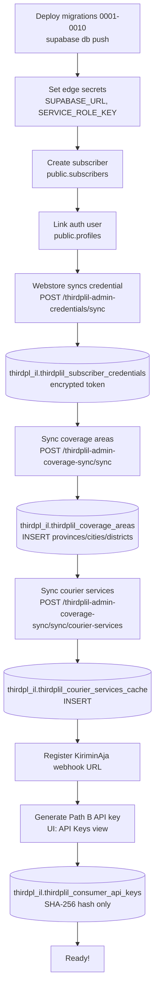
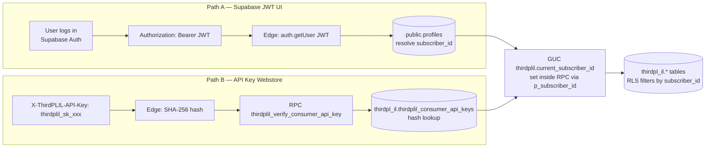
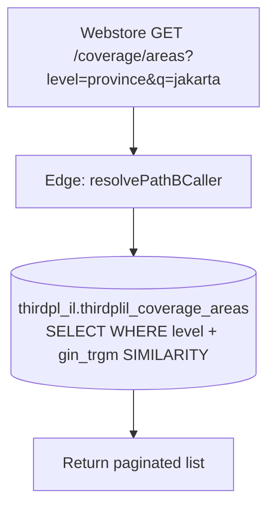
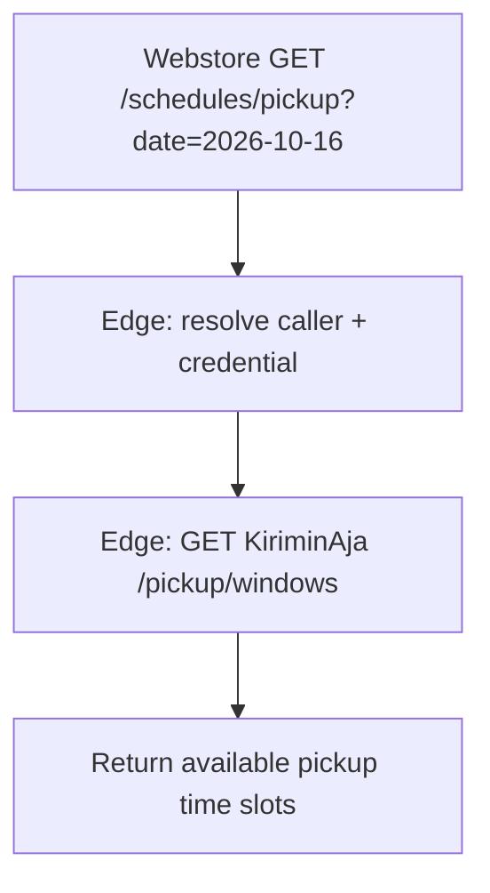
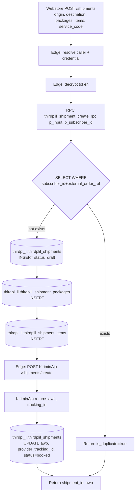
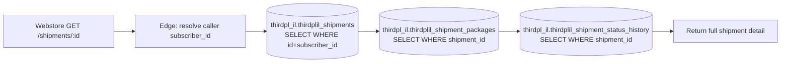
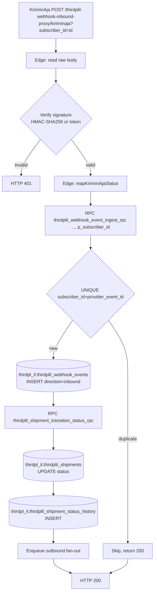
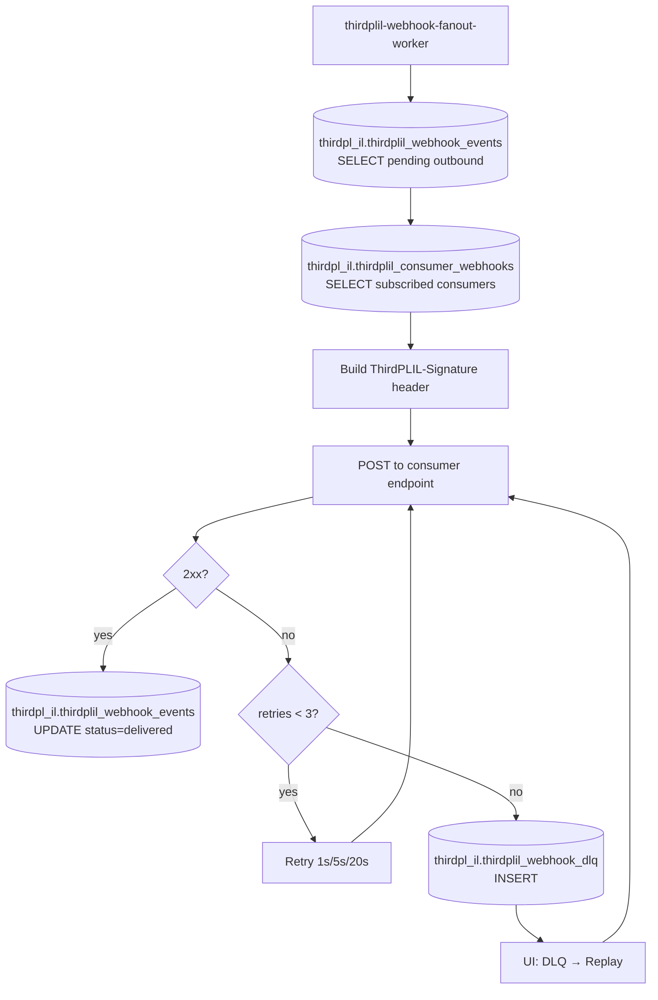
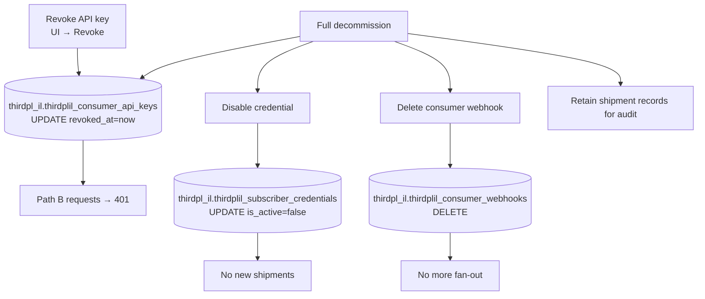

# ThirdPLIL — API Workflows & Integration Guide

- **Status**: LIVE — all ThirdPLIL migrations 0001–0010 + PGIL 0001–0009 applied and tracked in `schema_migrations`. `thirdpl_il` schema active.
- **Audience**: (A) Platform admin onboarding a subscriber to ThirdPLIL, (B) Webstore backend engineer integrating via Path B API key.

---

## 1.5 Standard Response Envelope

All ThirdPLIL edge functions return a standardized envelope:

```jsonc
{
  "success": true | false,
  "data": <T | null>,              // null on error
  "errors": null | [               // null on success
    {
      "code": "field_required",
      "message": "origin_address_line wajib diisi.",
      "field": "origin_address_line",   // null for non-field errors
      "http_status": 422
    }
  ],
  "is_duplicate": null | true,     // set true when external_order_ref / transaction_id dedup hits
  "duplicate_of_id": null | number | string,
  "warnings": null | string[]      // informational messages (e.g. "PIN stripped")
}
```

**Auth headers (Path B — Webstore):**
```
X-ThirdPLIL-API-Key: thirdplil_sk_live_<raw>       (REQUIRED)
X-ThirdPLIL-Credential-ID: <credential_id>          (OPTIONAL — override default credential)
X-ThirdPLIL-Transaction-ID: <idempotency_key>       (OPTIONAL — alias for shipment dedup)
Content-Type: application/json
```

**Auth headers (Path A — UI):**
```
Authorization: Bearer <supabase_jwt>
Content-Type: application/json
```

---

## 1. Scope

ThirdPLIL is a **provider-abstraction layer for third-party logistics (3PL)**, Phase 1 = KiriminAja.

- Coverage areas (provinces → cities → districts → subdistricts) with `gin_trgm` search.
- Courier services catalog cache.
- Rate quotes with volumetric weight recompute.
- Pickup schedule windows.
- Shipment creation, tracking, cancellation, AWB label.
- Dual-path auth: Path A (Supabase JWT for UI), Path B (`X-ThirdPLIL-API-Key` SHA-256 for Webstore).
- Webstore owns KiriminAja credentials (syncs to ThirdPLIL).
- Inbound webhook proxy + outbound fan-out to Webstore (HMAC-SHA256, DLQ, replay).
- Always `subscriber_id` (never `tenant_id`); reuses `public.subscribers` + `public.profiles`.
- Tables intended for `thirdpl_il` schema (migration 0009 moves them from `public`).

---

## 2. KiriminAja APIs Used

| ThirdPLIL Operation | KiriminAja Endpoint | Method |
|:---|:---|:---|
| Coverage areas | `/api/v2/locations` | GET |
| Courier services | `/api/v2/courier-services` | GET |
| Rate quote | `/api/v2/rates/price` | POST |
| Pickup windows | `/api/v2/pickup/windows` | GET |
| Create shipment | `/api/v2/shipments/create` | POST |
| AWB label | `/api/v2/shipments/{awb}/label` | GET |
| Cancel shipment | `/api/v2/shipments/{awb}/cancel` | POST |
| Pickup schedule | `/api/v2/pickup/schedule` | POST |
| Return shipment | `/api/v2/shipments/{awb}/return` | POST |
| Credit balance | `/api/v2/credit/balance` | GET |
| Validate PIN | `/api/v2/credit/validate-pin` | POST |

Base URLs: `https://tdev.kiriminaja.com/api/v2` (sandbox), `https://client.kiriminaja.com/api/v2` (prod).
Auth: Bearer token from `thirdplil_subscriber_credentials.token` (decrypted edge-side).

---

## 3. Onboarding Flow



### 3.1 Deploy
- `supabase db push` (applies ThirdPLIL 0001–0010 + PGIL 0001–0009).
- Verify `thirdpl_il` schema exists after migration 0009.

### 3.2 Credential Sync
```http
POST /functions/v1/thirdplil-admin-credentials/credentials
Authorization: Bearer <supabase-jwt>
Content-Type: application/json
```
Request body:
```jsonc
{
  "account_label": "KA Sandbox - Toko Utama",
  "provider_slug": "kiriminaja",
  "is_sandbox": true,
  "api_user": "admin@tokoutama.com",          // KA account email
  "api_key": "ka_live_abc123...",              // raw KA API secret (encrypted edge-side AES-GCM)
  "api_url_base": "https://tdev.kiriminaja.com/api/v2",
  "default_sender_name": "Toko Utama",
  "default_sender_phone": "081234567890",
  "default_sender_address": "Jl. Contoh No. 1, Jakarta",
  "ka_credit_enabled": false
}
```
Response 201:
```jsonc
{
  "success": true,
  "data": {
    "credential": {
      "id": 42,
      "subscriber_id": 7,
      "provider_id": 1,
      "provider_slug": "kiriminaja",
      "is_sandbox": true,
      "is_default": true,
      "account_label": "KA Sandbox - Toko Utama",
      "api_user": "admin@tokoutama.com"
    },
    "raw_key_once": "a3f8b2c1...64hex",        // webhook secret — shown ONCE
    "webhook_url": "https://<project-ref>.supabase.co/functions/v1/thirdplil-webhook-inbound-proxy?subscriber_id=7&wh_secret=a3f8b2c1...&provider=kiriminaja"
  },
  "warnings": [
    "Simpan webhook_url ini sekarang — raw wh_secret hanya ditampilkan sekali.",
    "Paste webhook_url ke KiriminAja dashboard → Settings → Webhook."
  ]
}
```

### 3.3 Coverage Sync
```http
POST /functions/v1/thirdplil-admin-coverage-sync/sync
```
Pulls all provinces/cities/districts from KiriminAja into `thirdplil_coverage_areas`. Subdistricts are on-demand (too many rows).

### 3.4 Generate Path B API Key
UI → API Keys → Generate. Raw key shown once (`thirdplil_sk_sandbox_...`).

---

## 4. Auth Workflow



### 4.1 `p_subscriber_id` pattern
Same as PGIL: GUC doesn't persist across PostgREST RPC calls. All public RPCs accept `p_subscriber_id bigint DEFAULT NULL` and set the GUC internally.

### 4.2 Outbound webhook signature
```
ThirdPLIL-Signature: t=<unix_ms>,v1=<hex_hmac_sha256(t.payload, consumer_secret)>
```
64-hex consumer secret shown once. ±5 min clock skew, constant-time compare.

---

## 5. Consumer-Facing API Endpoint Workflows

Base: `https://<project-ref>.supabase.co/functions/v1`

### 5.1 `GET /coverage/areas` — Coverage Lookup


Supports levels: `province`, `city`, `district`, `subdistrict`. Parent filter via `parent_id`.

**Request:**
```http
GET /functions/v1/thirdplil-rates/coverage/areas?level=district&parent_id=3171&q=tanah
X-ThirdPLIL-API-Key: thirdplil_sk_live_abc123...
```
Query params:

| Param | Type | Required | Description |
|:---|:---|:---|:---|
| `level` | enum | yes | `province` \| `city` \| `district` \| `subdistrict` |
| `q` | string | no | Fuzzy search on name (gin_trgm similarity) |
| `parent_id` | int | no | Filter by parent area id (e.g. districts of a city) |
| `limit` | int | no | Page size (default 50, max 200) |
| `offset` | int | no | Pagination offset |

**Response 200:**
```jsonc
{
  "success": true,
  "data": [
    { "id": 3171010, "level": "district", "parent_id": 3171, "code": "31.71.01", "name": "Tanah Abang", "full_path": "DKI Jakarta > Jakarta Pusat > Tanah Abang" },
    { "id": 3171020, "level": "district", "parent_id": 3171, "code": "31.71.02", "name": "Menteng", "full_path": "DKI Jakarta > Jakarta Pusat > Menteng" }
  ],
  "warnings": null
}
```

### 5.2 `POST /rates` — Rate Quote

```mermaid
flowchart TD
    A[Webstore POST /rates<br/>origin_subdistrict_id, dest_subdistrict_id, weight_g, dimensions] --> B[Edge: resolve caller + credential]
    B --> C[(thirdpl_il.thirdplil_subscriber_credentials<br/>default or X-ThirdPLIL-Credential-Ref)]
    C --> D[Edge: decrypt token]
    D --> E[Edge: volumetric weight recompute<br/>max(actual, vol)]
    E --> F[Edge: POST KiriminAja /rates/price]
    F --> G[KiriminAja returns service rates]
    G --> H[Edge: normalize to RateQuote envelope]
    H --> I[Return list of rate quotes]
```

**Request:**
```http
POST /functions/v1/thirdplil-rates/rates
X-ThirdPLIL-API-Key: thirdplil_sk_live_abc123...
Content-Type: application/json
```
```jsonc
{
  "origin_subdistrict_id": 3171010,
  "destination_subdistrict_id": 3273090,
  "weight_g": 1500,
  "length_cm": 30,
  "width_cm": 20,
  "height_cm": 15,
  "declared_value_idr": "250000",
  "cod_amount_idr": null,
  "is_cold_chain": false,
  "is_heavy_cargo": false
}
```
Body fields:

| Field | Type | Required | Description |
|:---|:---|:---|:---|
| `origin_subdistrict_id` | int | yes | Origin subdistrict (from coverage lookup) |
| `destination_subdistrict_id` | int | yes | Destination subdistrict |
| `weight_g` | int | yes | Actual weight in grams |
| `length_cm` / `width_cm` / `height_cm` | int | no | Package dimensions for volumetric calc |
| `declared_value_idr` | string | no | Declared goods value (for insurance) |
| `cod_amount_idr` | string | no | COD amount to collect |
| `is_cold_chain` | bool | no | Cold chain shipment |
| `is_heavy_cargo` | bool | no | Heavy cargo flag |

**Response 200:**
```jsonc
{
  "success": true,
  "data": [
    {
      "provider_slug": "kiriminaja",
      "provider_credential_id": 42,
      "courier_code": "jne",
      "courier_name": "JNE",
      "courier_service_code": "REG",
      "courier_service_name": "Regular (2-3 hari)",
      "service_tier": "regular",
      "etd_days_min": 2,
      "etd_days_max": 3,
      "billed_weight_g": 1500,
      "base_fee_idr": "18000",
      "insurance_fee_idr": "2500",
      "cod_fee_idr": null,
      "platform_service_fee_idr": "1000",
      "grand_total_idr": "21500",
      "supports_cod": true,
      "supports_insurance": true,
      "can_pickup_today": false
    },
    {
      "provider_slug": "kiriminaja",
      "provider_credential_id": 42,
      "courier_code": "jne",
      "courier_name": "JNE",
      "courier_service_code": "YES",
      "courier_service_name": "YES (Yakin Esok Sampai)",
      "service_tier": "express",
      "etd_days_min": 1,
      "etd_days_max": 1,
      "billed_weight_g": 1500,
      "base_fee_idr": "32000",
      "grand_total_idr": "35500",
      "supports_cod": true
    }
  ],
  "warnings": null
}
```

### 5.3 `GET /schedules/pickup` — Pickup Windows



**Request:**
```http
GET /functions/v1/thirdplil-schedules/pickup?origin_subdistrict_id=3171010&date_local=2026-10-16&env=sandbox
X-ThirdPLIL-API-Key: thirdplil_sk_live_abc123...
```
Query params:

| Param | Type | Required | Description |
|:---|:---|:---|:---|
| `origin_subdistrict_id` | int | yes | Origin subdistrict (for courier coverage check) |
| `date_local` | string | yes | Pickup date `YYYY-MM-DD` |
| `env` | enum | no | `sandbox` (default) \| `production` — picks the right credential |
| `X-ThirdPLIL-Credential-ID` | header | no | Override default credential |

**Response 200:**
```jsonc
{
  "success": true,
  "data": [
    {
      "window_id": "ka-2026-10-16-AM",
      "date_local": "2026-10-16",
      "start_time": "09:00",
      "end_time": "12:00",
      "status": "available",
      "cut_off_time_local": "2026-10-15 18:00",
      "driver_note_max_chars": 100,
      "fee_idr": null,
      "capacity_remaining_pct": 80
    },
    {
      "window_id": "ka-2026-10-16-PM",
      "date_local": "2026-10-16",
      "start_time": "13:00",
      "end_time": "17:00",
      "status": "full",
      "cut_off_time_local": "2026-10-16 10:00",
      "capacity_remaining_pct": 0
    }
  ],
  "warnings": null
}
```
`status` enum: `available` \| `full` \| `cutoff_passed` \| `suspended`.

### 5.4 `POST /shipments` — Create Shipment



**Idempotency**: `transaction_id` (or `X-ThirdPLIL-Transaction-ID` header) is the dedup key.

**Request:**
```http
POST /functions/v1/thirdplil-shipments/
X-ThirdPLIL-API-Key: thirdplil_sk_live_abc123...
X-ThirdPLIL-Transaction-ID: WS-ORD-2026-1001
Content-Type: application/json
```
```jsonc
{
  "origin_subdistrict_id": 3171010,
  "origin_address_line": "Jl. Contoh No. 1, RT 01/RW 02",
  "origin_contact_name": "Toko Utama",
  "origin_contact_phone": "081234567890",
  "origin_contact_email": "admin@tokoutama.com",
  "destination_subdistrict_id": 3273090,
  "destination_address_line": "Jl. Merdeka No. 45",
  "destination_contact_name": "Budi Santoso",
  "destination_contact_phone": "089876543210",
  "destination_contact_email": "budi@example.com",
  "selected_courier_service_code": "REG",
  "payment_method": "postpaid",
  "cod_amount_idr": null,
  "declared_value_total_idr": "250000",
  "is_insurance_enabled": true,
  "pickup_window_id": "ka-2026-10-16-AM",
  "pickup_date_local": "2026-10-16",
  "pickup_start_time": "09:00",
  "pickup_end_time": "12:00",
  "pickup_driver_note": "Pintu depan, tanya Pak RT",
  "packages": [
    {
      "actual_weight_g": 1200,
      "length_cm": 30, "width_cm": 20, "height_cm": 15,
      "description": "1 dus kaos + 1 dus celana",
      "items": [
        { "sku": "KAOS-001", "name": "Kaos Polos Putih", "qty": 3, "unit_value_idr": "65000", "is_fragile": false },
        { "sku": "CLN-002", "name": "Celana Jeans", "qty": 1, "unit_value_idr": "155000", "is_fragile": false }
      ]
    },
    {
      "actual_weight_g": 300,
      "items": [
        { "sku": "AKS-010", "name": "Topi", "qty": 1, "unit_value_idr": "30000" }
      ]
    }
  ]
}
```
Required body fields: `origin_subdistrict_id`, `origin_address_line`, `origin_contact_name`, `origin_contact_phone`, `destination_subdistrict_id`, `destination_address_line`, `destination_contact_name`, `destination_contact_phone`, `selected_courier_service_code`, `packages` (min 1, max 20; each package needs `actual_weight_g > 0` and ≥1 item with `name`, `qty > 0`, `unit_value_idr`).

**Response 200 (created):**
```jsonc
{
  "success": true,
  "data": {
    "id": 8842,
    "subscriber_id": 7,
    "provider_credential_id": 42,
    "provider_slug": "kiriminaja",
    "is_sandbox": true,
    "transaction_id": "WS-ORD-2026-1001",
    "status": "booked",
    "courier_service_code": "REG",
    "courier_service_name": "Regular (2-3 hari)",
    "courier_code": "jne",
    "courier_name": "JNE",
    "provider_order_id": "KA-20261015-ABC123",
    "awb_no": "JNE1234567890",
    "origin_subdistrict_id": 3171010,
    "destination_subdistrict_id": 3273090,
    "origin_address_line": "Jl. Contoh No. 1, RT 01/RW 02",
    "origin_contact_name": "Toko Utama",
    "origin_contact_phone": "081234567890",
    "destination_address_line": "Jl. Merdeka No. 45",
    "destination_contact_name": "Budi Santoso",
    "destination_contact_phone": "089876543210",
    "payment_method": "postpaid",
    "total_packages": 2,
    "total_actual_weight_g": 1500,
    "total_billed_weight_g": 1500,
    "grand_total_fee_idr": "21500",
    "insurance_fee_idr": "2500",
    "is_insurance_enabled": true,
    "platform_service_fee_idr": "1000",
    "pickup_window_id": "ka-2026-10-16-AM",
    "pickup_date_local": "2026-10-16",
    "pickup_start_time": "09:00",
    "pickup_end_time": "12:00",
    "created_at": "2026-10-15T03:30:00Z",
    "updated_at": "2026-10-15T03:30:05Z"
  },
  "is_duplicate": false,
  "duplicate_of_id": null,
  "warnings": null
}
```

**Response 200 (duplicate — same `transaction_id` already exists):**
```jsonc
{
  "success": true,
  "data": null,
  "is_duplicate": true,
  "duplicate_of_id": 8842,
  "warnings": ["Transaksi dedup terdeteksi — 0 data baru ditulis."]
}
```

**Response 422 (validation error):**
```jsonc
{
  "success": false,
  "data": null,
  "errors": [
    { "code": "field_required", "message": "origin_address_line wajib diisi.", "field": "origin_address_line", "http_status": 422 },
    { "code": "items_empty", "message": "packages[0].items wajib minimal 1 item.", "field": "packages[0].items", "http_status": 422 }
  ]
}
```

### 5.5 `GET /shipments/:id` — Shipment Detail



**Request:**
```http
GET /functions/v1/thirdplil-shipments/8842
X-ThirdPLIL-API-Key: thirdplil_sk_live_abc123...
```

**Response 200:**
```jsonc
{
  "success": true,
  "data": {
    "shipment": {
      "id": 8842,
      "subscriber_id": 7,
      "transaction_id": "WS-ORD-2026-1001",
      "status": "in_transit",
      "courier_service_code": "REG",
      "courier_name": "JNE",
      "awb_no": "JNE1234567890",
      "origin_subdistrict_id": 3171010,
      "destination_subdistrict_id": 3273090,
      "origin_address_line": "Jl. Contoh No. 1",
      "origin_contact_name": "Toko Utama",
      "origin_contact_phone": "081234567890",
      "destination_address_line": "Jl. Merdeka No. 45",
      "destination_contact_name": "Budi Santoso",
      "destination_contact_phone": "089876543210",
      "payment_method": "postpaid",
      "total_packages": 2,
      "total_actual_weight_g": 1500,
      "grand_total_fee_idr": "21500",
      "pickup_date_local": "2026-10-16",
      "pickup_start_time": "09:00",
      "pickup_end_time": "12:00",
      "created_at": "2026-10-15T03:30:00Z",
      "updated_at": "2026-10-16T08:12:00Z"
    },
    "packages": [
      {
        "id": 1201,
        "shipment_id": 8842,
        "package_seq": 1,
        "actual_weight_g": 1200,
        "billed_weight_g": 1200,
        "awb_no": "JNE1234567890",
        "awb_label_storage": "2026-10/1728950000_AWB-JNE1234567890.pdf",
        "items": [
          { "id": 1, "package_id": 1201, "sku": "KAOS-001", "name": "Kaos Polos Putih", "qty": 3, "unit_value_idr": "65000" }
        ]
      }
    ],
    "history": [
      { "id": 1001, "shipment_id": 8842, "from_status": "draft", "to_status": "booked", "created_at": "2026-10-15T03:30:05Z" },
      { "id": 1002, "shipment_id": 8842, "from_status": "booked", "to_status": "in_transit", "created_at": "2026-10-16T08:12:00Z" }
    ]
  }
}
```

### 5.6 `DELETE /shipments/:id` — Cancel Shipment

```mermaid
flowchart TD
    A[Webstore DELETE /shipments/:id] --> B[RPC thirdplil_shipment_transition_status_rpc]
    B --> C[SET GUC thirdplil.current_subscriber_id]
    C --> D[(thirdpl_il.thirdplil_shipments<br/>SELECT status FOR UPDATE)]
    D --> E{already terminal?}
    E -- yes --> F[Return skipped=true]
    E -- no --> G[Edge: POST KiriminAja /shipments/{awb}/cancel]
    G --> H[(thirdpl_il.thirdplil_shipments<br/>UPDATE status=canceled)]
    H --> I[(thirdpl_il.thirdplil_shipment_status_history<br/>INSERT old → canceled)]
    I --> J[Return true]
    F --> J
```

**Request:**
```http
DELETE /functions/v1/thirdplil-shipments/8842
X-ThirdPLIL-API-Key: thirdplil_sk_live_abc123...
```

**Response 200 (canceled):**
```jsonc
{
  "success": true,
  "data": {
    "ok": true,
    "shipment_id": 8842,
    "prior_status": "booked",
    "new_status": "canceled",
    "skipped": false,
    "skip_reason": null,
    "history_id": 1003,
    "webhooks_enqueued": 1
  }
}
```

**Response 200 (skipped — already terminal):**
```jsonc
{
  "success": true,
  "data": {
    "ok": true,
    "shipment_id": 8842,
    "prior_status": "delivered",
    "new_status": "delivered",
    "skipped": true,
    "skip_reason": "status already terminal",
    "history_id": null,
    "webhooks_enqueued": 0
  },
  "warnings": ["Transition skipped (no-op guard): status already terminal"]
}
```

### 5.6b `PATCH /shipments/:id/status` — Status Transition

Manual status override (e.g. `pickup_scheduled`, `pickup_completed`). Validated against the 19-value shipment status enum.

**Request:**
```http
PATCH /functions/v1/thirdplil-shipments/8842/status
X-ThirdPLIL-API-Key: thirdplil_sk_live_abc123...
Content-Type: application/json
```
```jsonc
{
  "new_status": "pickup_scheduled",
  "meta": { "driver_name": "Andi", "driver_phone": "0813xxxx" }
}
```

**Response 200:** Same `TransitionStatusResponse` shape as §5.6.

**Response 422 (invalid status):**
```jsonc
{
  "success": false,
  "data": null,
  "errors": [
    { "code": "invalid_status", "message": "new_status tidak valid / tidak termasuk enum 19 nilai.", "field": "new_status", "http_status": 422 }
  ]
}
```

### 5.7 `GET /shipments/:id/awb-label` — AWB Label

```mermaid
flowchart TD
    A[Webstore GET /shipments/:id/awb-label] --> B[Edge: resolve caller]
    B --> C[(thirdpl_il.thirdplil_shipments<br/>SELECT awb, awb_label_storage)]
    C --> D{awb_label_storage set?}
    D -- yes --> E[Fetch from Supabase Storage]
    D -- no --> F[Edge: GET KiriminAja /shipments/{awb}/label]
    F --> G[Edge: upload to Storage]
    G --> H[(thirdpl_il.thirdplil_shipments<br/>UPDATE awb_label_storage)]
    E --> I[Return label URL/PDF]
    H --> I
```

**Request:**
```http
GET /functions/v1/thirdplil-shipments/8842/awb-label?redirect=false
X-ThirdPLIL-API-Key: thirdplil_sk_live_abc123...
```

**Response 200:**
```jsonc
{
  "success": true,
  "data": {
    "url": "https://<project-ref>.supabase.co/storage/v1/object/sign/awb-labels/2026-10/1728950000_AWB-JNE1234567890.pdf?token=...",
    "storage_object_key": "2026-10/1728950000_AWB-JNE1234567890.pdf",
    "content_type": "application/pdf",
    "filename": "1728950000_AWB-JNE1234567890.pdf",
    "expires_at": "2026-10-15T03:45:00Z"
  }
}
```
With `?redirect=true`, returns **302 redirect** to the signed storage URL instead of JSON.

**Response 404 (AWB not yet available):**
```jsonc
{
  "success": false,
  "data": null,
  "errors": [
    { "code": "awb_missing", "message": "AWB belum tersedia. Hubungi provider atau cek beberapa saat lagi.", "field": null, "http_status": 404 }
  ]
}
```

---

## 6. Webhook Workflow

### 6.1 Inbound: KiriminAja → ThirdPLIL



### 6.2 Outbound: ThirdPLIL → Webstore (Fan-Out)



**Outbound POST to consumer endpoint:**
```http
POST https://webstore.example.com/api/thirdplil/webhook
Content-Type: application/json
X-ThirdPLIL-Event-Type: shipment.status_changed
X-ThirdPLIL-Idempotency-Key: evt_8842_in_transit_1728975120
X-ThirdPLIL-Queue-Id: 5521
X-ThirdPLIL-Attempt: 1/3
X-ThirdPLIL-Signature: t=1728975120500,v1=a1b2c3d4e5f6...
User-Agent: ThirdPLIL-FanOut/1.0
```
```jsonc
{
  "event_id": 5521,
  "event_type": "shipment.status_changed",
  "idempotency_key": "evt_8842_in_transit_1728975120",
  "subscriber_id": 7,
  "shipment_id": 8842,
  "inbound_webhook_event_id": 4102,
  "timestamp": "2026-10-15T05:12:00.500Z",
  "data": {
    "shipment_id": 8842,
    "awb_no": "JNE1234567890",
    "transaction_id": "WS-ORD-2026-1001",
    "prior_status": "booked",
    "new_status": "in_transit",
    "event_time": "2026-10-16T08:12:00Z",
    "location": "Jakarta Hub",
    "description": "Shipment picked up and in transit"
  }
}
```

**Signature verification** (consumer side):
1. Parse `t=` timestamp and `v1=` hex from `X-ThirdPLIL-Signature`.
2. Reconstruct signing string: `"<t>.<raw_body>"`.
3. Compute `HMAC-SHA256(webstore_secret, signing_string)` and compare (constant-time) to the `v1` hex.
4. Reject if timestamp drifts > 5 minutes (replay protection).

Common `event_type` values: `shipment.status_changed`, `shipment.booked`, `shipment.canceled`, `shipment.delivered`, `shipment.exception`.


---

## 7. Offboarding Flow



---

## 8. Staging Readiness Checklist

| Item | Status |
|:---|:---|
| Migrations 0001–0010 applied | ✅ All applied + tracked in `schema_migrations` |
| `thirdpl_il` schema exists | ✅ Migration 0009 applied |
| All RPCs have `p_subscriber_id` | ✅ (migration 0007) |
| 9 edge functions | ✅ |
| Frontend ThirdPLIL views | ✅ |
| Real KiriminAja sandbox credential | ⚠️ Run sync with real token |
| KiriminAja webhook URL | ⚠️ Configure in KiriminAja dashboard |
| Coverage sync run | ⚠️ Run POST /sync |
