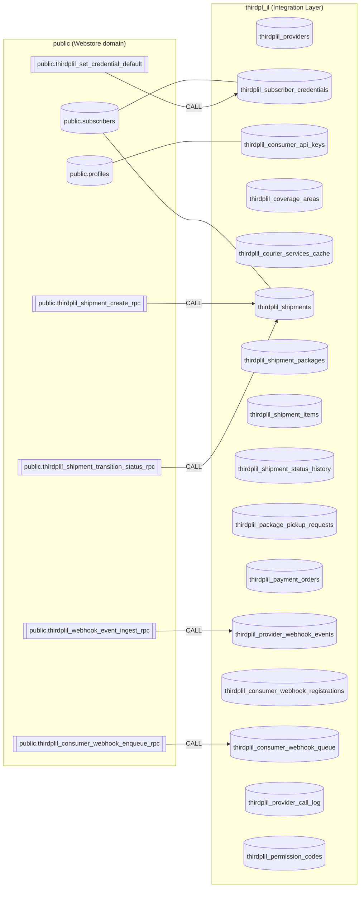
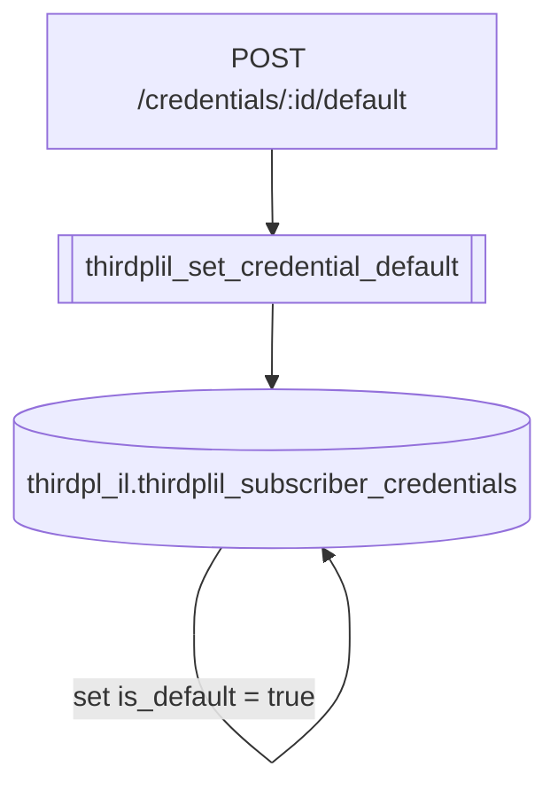
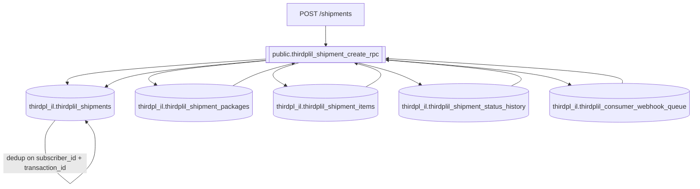
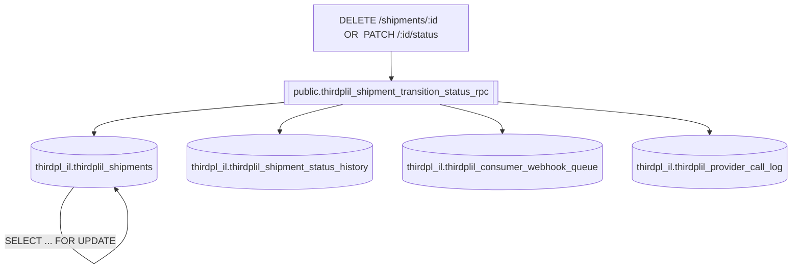
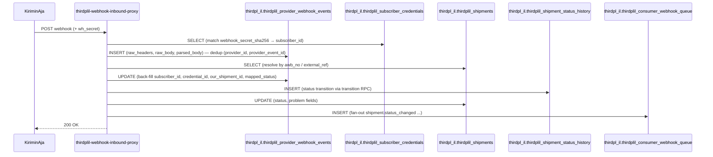
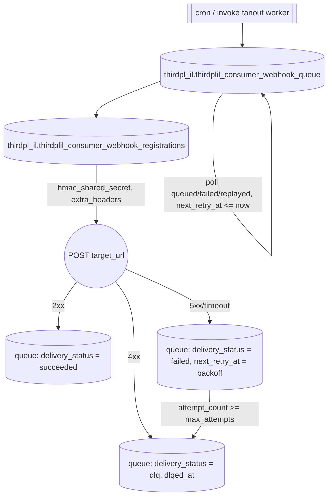

# ThirdPLIL — Table Schema & Data Lifecycle

- **Status**: LIVE — ThirdPLIL migrations 0001–0010 applied. `thirdpl_il` schema active (migration 0009 moved all IL tables out of `public`).
- **Source of truth**: This document was authored from live DB introspection of the local `supabase_db_InezWebstoreSupabase` instance (authoritative column names, types, nullability, defaults, constraints, enums, indexes).
- **Audience**: Backend engineers and DBAs maintaining ThirdPLIL; integration engineers needing to know exactly which tables each endpoint mutates.
- **Companions**: [01-api-workflows.md](file:///home/calvin/WebstoreGroup/WebstoreSupabase/supabase/docs/ThirdPLIL/01-api-workflows.md), [KiriminAja/02-data-model.md](file:///home/calvin/WebstoreGroup/WebstoreSupabase/supabase/docs/ThirdPLIL/KiriminAja/02-data-model.md), [KiriminAja/04-webhook-spec.md](file:///home/calvin/WebstoreGroup/WebstoreSupabase/supabase/docs/ThirdPLIL/KiriminAja/04-webhook-spec.md).

---

## 0. Schema Map

- `thirdpl_il` — **all** ThirdPLIL tables + the real RPC implementations.
- `thirdplil_private` — internal helpers only (no PostgREST exposure): GUC/tenancy resolvers, credential default setter, API-key verifier, webhook enqueue, PIN masking, audit cleaners.
- `public` — thin `SECURITY INVOKER` **alias wrappers** for PostgREST-exposed RPCs (`public.thirdplil_*_rpc`). PostgREST exposes only the `public` schema.
- `public.subscribers` / `public.profiles` — shared tenancy tables (owned by Webstore). `subscriber_id` is the tenancy boundary everywhere.
- `extensions` — `pgcrypto` (`digest()`), `pg_trgm` (coverage name search).



---

## 1. Tables

### 1.1 Registry & Provider Config

#### `thirdpl_il.thirdplil_providers`
Provider registry. Phase 1 = KiriminAja only.

| Column | Type | Null | Default | Notes |
|:---|:---|:---|:---|:---|
| `provider_id` | bigint | NOT NULL | `nextval` | PK |
| `slug` | `thirdplil_provider_slug` | NOT NULL | — | UNIQUE (`thirdplil_providers_slug_key`) |
| `display_name` | text | NOT NULL | — | |
| `base_url_sandbox` | text | NOT NULL | — | |
| `base_url_production` | text | NOT NULL | — | |
| `docs_url` | text | NULL | — | |
| `enabled` | boolean | NOT NULL | `true` | |
| `capabilities` | jsonb | NOT NULL | `'{}'` | |
| `created_at` / `updated_at` | timestamptz | NOT NULL | `now()` | |

#### `thirdpl_il.thirdplil_permission_codes`
Permission catalog for Path A UI RBAC.

| Column | Type | Null | Default | Notes |
|:---|:---|:---|:---|:---|
| `code` | text | NOT NULL | — | PK |
| `description` | text | NOT NULL | — | |
| `created_at` | timestamptz | NOT NULL | `now()` | |

---

### 1.2 Tenancy & Credentials

#### `thirdpl_il.thirdplil_subscriber_credentials`
Per-subscriber KiriminAja credentials. **Raw API key is never stored** — only AES-GCM ciphertext (`THIRDPLIL_KEK` edge secret). Webhook secret stored as SHA-256 only.

| Column | Type | Null | Default | Notes |
|:---|:---|:---|:---|:---|
| `credential_id` | bigint | NOT NULL | `nextval` | PK |
| `subscriber_id` | bigint | NOT NULL | — | FK → `public.subscribers` |
| `provider_id` | bigint | NOT NULL | — | FK → `thirdplil_providers` |
| `is_sandbox` | boolean | NOT NULL | `true` | |
| `account_label` | text | NOT NULL | — | UNIQUE per group (`thirdplil_tcred_unique_label_per_group`) |
| `is_default` | boolean | NOT NULL | `false` | **Max 1 `true`** per `(subscriber_id, provider_id, is_sandbox)` — enforced by exclusion constraint (`thirdplil_tcred_one_default_per_group`) |
| `api_key_encrypted` | bytea | NOT NULL | — | AES-GCM ciphertext (base64 payload) |
| `api_email` | text | NULL | — | KA account email |
| `webhook_secret_sha256` | text | NULL | — | SHA-256 of KA webhook secret; raw shown once |
| `default_sender_name` | text | NULL | — | |
| `default_sender_phone` | text | NULL | — | |
| `default_sender_address` | text | NULL | — | |
| `default_sender_subdistrict_id` | bigint | NULL | — | FK → `thirdplil_coverage_areas` (`thirdplil_tcred_sender_subdistrict_fk`) |
| `ka_credit_enabled` | boolean | NOT NULL | `false` | |
| `top_enabled` | boolean | NOT NULL | `false` | |
| `last_test_conn_at` | timestamptz | NULL | — | |
| `last_test_conn_ok` | boolean | NULL | — | |
| `created_at` / `updated_at` | timestamptz | NOT NULL | `now()` | |

Indexes: `thirdplil_tcred_sub_provider_idx`, `thirdplil_tcred_one_default_per_group`, `thirdplil_tcred_unique_label_per_group`, `thirdplil_tcred_wh_secret_sha256_idx`.

#### `thirdpl_il.thirdplil_consumer_api_keys`
Path B API keys for Webstore → ThirdPLIL server-to-server calls. Stored as SHA-256 hash only.

| Column | Type | Null | Default | Notes |
|:---|:---|:---|:---|:---|
| `key_id` | bigint | NOT NULL | `nextval` | PK |
| `subscriber_id` | bigint | NOT NULL | — | FK → `public.subscribers` |
| `key_prefix` | text | NOT NULL | — | e.g. `thirdplil_sk_live_` |
| `key_hash` | text | NOT NULL | — | SHA-256; UNIQUE (`thirdplil_consumer_api_keys_key_hash_key`) |
| `label` | text | NOT NULL | — | |
| `scopes` | text[] | NOT NULL | `'{*}'` | |
| `expires_at` | timestamptz | NULL | — | |
| `last_used_at` | timestamptz | NULL | — | |
| `revoked_at` | timestamptz | NULL | — | |
| `created_at` | timestamptz | NOT NULL | `now()` | |
| `created_by_profile_id` | uuid | NULL | — | FK → `public.profiles` |

---

### 1.3 Coverage & Courier Catalog

#### `thirdpl_il.thirdplil_coverage_areas`
Hierarchical provider coverage (province → city → district → subdistrict).

| Column | Type | Null | Default | Notes |
|:---|:---|:---|:---|:---|
| `area_id` | bigint | NOT NULL | `nextval` | PK |
| `level` | `thirdplil_coverage_level` | NOT NULL | — | |
| `provider_id` | bigint | NOT NULL | — | FK → `thirdplil_providers` |
| `parent_area_id` | bigint | NULL | — | Self FK |
| `name` | text | NOT NULL | — | |
| `name_ascii` | text | NULL | — | `gin_trgm` indexed (`thirdplil_cov_name_trgm_idx`) |
| `code_provider` | text | NULL | — | UNIQUE per provider+level (`thirdplil_cov_provider_code_unique`) |
| `postal_code` | text | NULL | — | |
| `metadata` | jsonb | NOT NULL | `'{}'` | |
| `standard_area_id` | bigint | NULL | — | |
| `created_at` / `updated_at` | timestamptz | NOT NULL | `now()` | |

#### `thirdpl_il.thirdplil_courier_services_cache`
Courier service catalog cache with volumetric/weight rules.

| Column | Type | Null | Default | Notes |
|:---|:---|:---|:---|:---|
| `cache_id` | bigint | NOT NULL | `nextval` | PK |
| `provider_id` | bigint | NOT NULL | — | FK → `thirdplil_providers` |
| `provider_service_code` | text | NOT NULL | — | UNIQUE per provider (`thirdplil_courier_unique_per_provider_code`) |
| `provider_service_name` | text | NOT NULL | — | |
| `delivery_mode` | `thirdplil_delivery_mode` | NOT NULL | `'express'` | |
| `volumetric_divisor` | integer | NOT NULL | `6000` | |
| `min_weight_g` | integer | NOT NULL | `1000` | |
| `weight_round_up_g` | integer | NOT NULL | `1000` | |
| `supports_insurance` | boolean | NOT NULL | `true` | |
| `supports_cod` | boolean | NOT NULL | `false` | |
| `cod_fee_percent` | numeric | NULL | — | |
| `insurance_percent` | numeric | NULL | — | |
| `insurance_min_fee_idr` | numeric | NULL | — | |
| `active` | boolean | NOT NULL | `true` | |
| `fetched_at` | timestamptz | NOT NULL | `now()` | |
| `expires_at` | timestamptz | NULL | — | |

---

### 1.4 Shipments

#### `thirdpl_il.thirdplil_shipments` (header)
All financial totals are **server-recomputed** (client amounts are never trusted).

| Column | Type | Null | Default | Notes |
|:---|:---|:---|:---|:---|
| `shipment_id` | bigint | NOT NULL | `nextval` | PK |
| `subscriber_id` | bigint | NOT NULL | — | FK → `public.subscribers` |
| `provider_id` | bigint | NOT NULL | — | FK → `thirdplil_providers` |
| `credential_id` | bigint | NOT NULL | — | FK → `thirdplil_subscriber_credentials` |
| `delivery_mode` | `thirdplil_delivery_mode` | NOT NULL | `'express'` | |
| `vehicle_type` | text | NULL | — | |
| `courier_service_code` / `courier_service_name` | text | NULL | — | |
| `transaction_id` | uuid | NOT NULL | — | **Idempotency key** — UNIQUE with `subscriber_id` (`thirdplil_shipments_subscriber_id_transaction_id_key`) |
| `external_ref` | text | NULL | — | Caller order ref |
| `awb_no` | text | NULL | — | |
| `awb_label_storage` | text | NULL | — | Storage object key |
| `awb_label_generated_at` | timestamptz | NULL | — | |
| `status` | `thirdplil_shipment_status` | NOT NULL | `'draft'` | |
| `sender_name` / `sender_phone` / `sender_address` | text | NOT NULL | — | |
| `sender_subdistrict_id` | bigint | NOT NULL | — | FK → `thirdplil_coverage_areas` |
| `recipient_name` / `recipient_phone` / `recipient_address` | text | NOT NULL | — | |
| `recipient_subdistrict_id` | bigint | NOT NULL | — | FK → `thirdplil_coverage_areas` |
| `recipient_subdistrict_name_cache` | text | NULL | — | |
| `base_shipping_fee_idr` | numeric | NOT NULL | `0` | |
| `cod_enabled` | boolean | NOT NULL | `false` | |
| `cod_amount_idr` / `cod_fee_idr` | numeric | NOT NULL | `0` | |
| `insurance_enabled` | boolean | NOT NULL | `false` | |
| `insurance_amount_idr` / `insurance_fee_idr` | numeric | NOT NULL | `0` | |
| `grand_total_idr` | numeric | NOT NULL | `0` | |
| `items_total_value_idr` | numeric | NOT NULL | `0` | |
| `total_actual_weight_g` / `total_billed_weight_g` | integer | NOT NULL | `0` | |
| `total_packages` | integer | NOT NULL | `1` | |
| `notes_for_courier` | text | NULL | — | |
| `pickup_scheduled_at` | timestamptz | NULL | — | |
| `problem_pending_code` / `problem_pending_reason` / `problem_pending_at` | text / text / timestamptz | NULL | — | |
| `problem_resolved_code` / `problem_resolved_at` | text / timestamptz | NULL | — | |
| `provider_data` | jsonb | NOT NULL | `'{}'` | |
| `created_at` / `updated_at` | timestamptz | NOT NULL | `now()` | |

Indexes: `thirdplil_shipments_sub_awb_idx`, `_sub_ext_ref_idx`, `_sub_sched_idx`, `_sub_status_idx`, `thirdplil_shipments_subscriber_id_transaction_id_key`.

#### `thirdpl_il.thirdplil_shipment_packages`

| Column | Type | Null | Default | Notes |
|:---|:---|:---|:---|:---|
| `package_id` | bigint | NOT NULL | `nextval` | PK |
| `shipment_id` | bigint | NOT NULL | — | FK → `thirdplil_shipments` (CASCADE) |
| `package_seq` | integer | NOT NULL | `1` | UNIQUE with shipment (`thirdplil_pkg_shipment_seq_unique`) |
| `tracking_no` / `awb_no` | text | NULL | — | |
| `description` | text | NULL | — | |
| `weight_g` | integer | NOT NULL | — | |
| `length_cm` / `width_cm` / `height_cm` | integer | NOT NULL | — | |
| `volumetric_weight_g` | integer | NOT NULL | — | Server-computed |
| `billed_weight_g` | integer | NOT NULL | — | Server-computed |
| `content_value_idr` | numeric | NOT NULL | `0` | |
| `is_fragile` | boolean | NOT NULL | `false` | |
| `picked_up_at` | timestamptz | NULL | — | |
| `pickup_request_id` | bigint | NULL | — | FK → `thirdplil_package_pickup_requests` (`thirdplil_pkg_pickup_fk`) |
| `created_at` / `updated_at` | timestamptz | NOT NULL | `now()` | |

#### `thirdpl_il.thirdplil_shipment_items`

| Column | Type | Null | Default | Notes |
|:---|:---|:---|:---|:---|
| `item_id` | bigint | NOT NULL | `nextval` | PK |
| `package_id` | bigint | NOT NULL | — | FK → `thirdplil_shipment_packages` |
| `shipment_id` | bigint | NOT NULL | — | FK → `thirdplil_shipments` |
| `sku` | text | NULL | — | |
| `name` | text | NOT NULL | — | |
| `qty` | integer | NOT NULL | `1` | |
| `unit_value_idr` | numeric | NOT NULL | `0` | |
| `line_value_idr` | numeric | NOT NULL | `0` | Server-computed (`qty × unit_value_idr`) |
| `weight_per_unit_g` | integer | NULL | — | |
| `category` | text | NULL | — | |
| `is_fragile` | boolean | NOT NULL | `false` | |
| `insurance_applied` | boolean | NOT NULL | `false` | |
| `description` | text | NULL | — | |
| `created_at` | timestamptz | NOT NULL | `now()` | |

#### `thirdpl_il.thirdplil_shipment_status_history` (append-only)
Every FSM transition appends a row. Webhook fan-out is derived from these transitions.

| Column | Type | Null | Default | Notes |
|:---|:---|:---|:---|:---|
| `history_id` | bigint | NOT NULL | `nextval` | PK |
| `shipment_id` | bigint | NOT NULL | — | FK → `thirdplil_shipments` |
| `status` | `thirdplil_shipment_status` | NOT NULL | — | |
| `occurred_at` | timestamptz | NOT NULL | `now()` | |
| `location_text` | text | NULL | — | |
| `location_subdistrict_id` | bigint | NULL | — | FK → `thirdplil_coverage_areas` |
| `raw_provider_status` / `raw_provider_status_code` | text | NULL | — | |
| `transition_reason` | jsonb | NULL | — | |
| `note` | text | NULL | — | |
| `source` | text | NOT NULL | `'internal'` | `internal` / `provider_webhook` / `api` |
| `source_event_ref` | text | NULL | — | Idempotency ref (`transaction_id` or inbound event id) |
| `actor` | text | NULL | — | |

Indexes: `thirdplil_status_hist_shipment_idx`, `thirdplil_status_hist_source_ref_idx`.

#### `thirdpl_il.thirdplil_package_pickup_requests`

| Column | Type | Null | Default | Notes |
|:---|:---|:---|:---|:---|
| `pickup_id` | bigint | NOT NULL | `nextval` | PK |
| `subscriber_id` | bigint | NOT NULL | — | FK → `public.subscribers` |
| `provider_id` | bigint | NOT NULL | — | FK → `thirdplil_providers` |
| `credential_id` | bigint | NOT NULL | — | FK → `thirdplil_subscriber_credentials` |
| `shipment_id` | bigint | NULL | — | FK → `thirdplil_shipments` |
| `provider_pickup_schedule_id` | text | NULL | — | |
| `pickup_date` | date | NOT NULL | — | |
| `pickup_start_time` / `pickup_end_time` | time | NOT NULL | — | |
| `pickup_time_window_label` | text | NULL | — | |
| `driver_name` / `driver_phone` / `driver_vehicle_plate` | text | NULL | — | |
| `picked_up_at` | timestamptz | NULL | — | |
| `pickup_status` | `thirdplil_pickup_status` | NOT NULL | `'requested'` | |
| `provider_reference` | jsonb | NULL | — | |
| `created_at` / `updated_at` | timestamptz | NOT NULL | `now()` | |

---

### 1.5 Payments (KA credit / COD / QR)

#### `thirdpl_il.thirdplil_payment_orders`
**The KiriminAja PIN is NEVER stored.** Only PIN-auth outcome metadata is persisted.

| Column | Type | Null | Default | Notes |
|:---|:---|:---|:---|:---|
| `payment_id` | bigint | NOT NULL | `nextval` | PK |
| `subscriber_id` | bigint | NOT NULL | — | FK → `public.subscribers` |
| `provider_id` | bigint | NOT NULL | — | FK → `thirdplil_providers` |
| `credential_id` | bigint | NOT NULL | — | FK → `thirdplil_subscriber_credentials` |
| `shipment_id` | bigint | NULL | — | FK → `thirdplil_shipments` |
| `pickup_id` | bigint | NULL | — | FK → `thirdplil_package_pickup_requests` |
| `external_ref` | text | NULL | — | |
| `payment_type` | `thirdplil_payment_type` | NOT NULL | — | |
| `amount_idr` | numeric | NOT NULL | — | |
| `currency` | text | NOT NULL | `'IDR'` | |
| `payment_status` | `thirdplil_payment_status` | NOT NULL | `'pending'` | |
| `ka_credit_requires_pin` | boolean | NOT NULL | `false` | |
| `ka_last_pin_auth_at` | timestamptz | NULL | — | PIN itself never stored |
| `ka_last_pin_auth_result` | text | NULL | — | |
| `ka_pin_auth_attempts_since_success` | integer | NOT NULL | `0` | |
| `qr_code_image_url` / `qr_code_content` | text | NULL | — | |
| `qr_expires_at` | timestamptz | NULL | — | |
| `provider_payment_ref` | text | NULL | — | |
| `provider_response` | jsonb | NOT NULL | `'{}'` | |
| `payment_link_url` | text | NULL | — | |
| `initiated_at` | timestamptz | NOT NULL | `now()` | |
| `paid_at` / `expires_at` | timestamptz | NULL | — | |
| `failure_code` / `failure_message` | text | NULL | — | |
| `cod_courier_collected_at` | timestamptz | NULL | — | |
| `cod_settlement_status` | `thirdplil_cod_settlement_status` | NULL | — | |
| `cod_settled_amount_idr` | numeric | NULL | — | |
| `cod_settled_at` | timestamptz | NULL | — | |
| `cod_dispute_reason` | text | NULL | — | |
| `created_at` / `updated_at` | timestamptz | NOT NULL | `now()` | |

Constraint: `thirdplil_payments_unique_per_shipment_and_type`; indexes `thirdplil_payments_sub_shipment_idx`, `_sub_status_idx`, `_provider_ref_idx`, `thirdplil_payments_cod_settlement_idx`.

---

### 1.6 Webhooks

#### `thirdpl_il.thirdplil_provider_webhook_events` (inbound, append-only)
Raw inbound KiriminAja webhooks with dedup + resolution.

| Column | Type | Null | Default | Notes |
|:---|:---|:---|:---|:---|
| `event_id` | bigint | NOT NULL | `nextval` | PK |
| `provider_id` | bigint | NOT NULL | — | FK → `thirdplil_providers` |
| `subscriber_id` | bigint | NULL | — | FK → `public.subscribers` (resolved via `wh_secret`) |
| `credential_id` | bigint | NULL | — | FK → `thirdplil_subscriber_credentials` |
| `provider_event_id` | text | NULL | — | UNIQUE with `provider_id` (`thirdplil_provider_webhook_ev_provider_id_provider_event_id_key`) |
| `provider_event_type` | text | NULL | — | |
| `occurred_at` / `received_at` | timestamptz | NOT NULL | `now()` | |
| `provider_shipment_ref` | text | NULL | — | AWB |
| `our_shipment_id` | bigint | NULL | — | FK → `thirdplil_shipments` |
| `raw_headers` / `raw_query_params` | jsonb | NOT NULL | `'{}'` | |
| `raw_body` | text | NULL | — | |
| `parsed_body` | jsonb | NULL | — | |
| `mapped_status` | `thirdplil_shipment_status` | NULL | — | |
| `mapped_event_type` | text | NULL | — | |
| `processed_successfully` | boolean | NULL | — | |
| `processing_error` | text | NULL | — | |
| `duplicate_of_event_id` | bigint | NULL | — | Self FK |

Indexes: `thirdplil_inwh_provider_time_idx`, `_shipment_idx`, `_subscriber_idx`.

#### `thirdpl_il.thirdplil_consumer_webhook_registrations` (outbound config)

| Column | Type | Null | Default | Notes |
|:---|:---|:---|:---|:---|
| `registration_id` | bigint | NOT NULL | `nextval` | PK |
| `subscriber_id` | bigint | NOT NULL | — | FK → `public.subscribers` |
| `label` | text | NOT NULL | — | |
| `target_url` | text | NOT NULL | — | |
| `http_method` | text | NOT NULL | `'POST'` | |
| `hmac_shared_secret` | text | NOT NULL | — | Signing secret |
| `hmac_algorithm` | text | NOT NULL | `'sha256'` | |
| `hmac_header_name` | text | NOT NULL | `'X-ThirdPLIL-Signature'` | |
| `subscribed_event_types` | `thirdplil_webhook_event_type[]` | NOT NULL | `ARRAY[]` | |
| `send_for_all_event_types` | boolean | NOT NULL | `false` | |
| `extra_headers` | jsonb | NOT NULL | `'{}'` | |
| `enabled` | boolean | NOT NULL | `true` | |
| `last_success_at` / `last_failure_at` | timestamptz | NULL | — | |
| `consecutive_failure_count` | integer | NOT NULL | `0` | |
| `paused_until` | timestamptz | NULL | — | Auto-pause on repeated failures |
| `created_at` / `updated_at` | timestamptz | NOT NULL | `now()` | |

#### `thirdpl_il.thirdplil_consumer_webhook_queue` (outbound queue + DLQ)
This table **is** the outbound queue and its DLQ (`delivery_status = 'dlq'`).

| Column | Type | Null | Default | Notes |
|:---|:---|:---|:---|:---|
| `queue_id` | bigint | NOT NULL | `nextval` | PK |
| `subscriber_id` | bigint | NOT NULL | — | FK → `public.subscribers` |
| `registration_id` | bigint | NOT NULL | — | FK → `thirdplil_consumer_webhook_registrations` |
| `shipment_id` | bigint | NULL | — | FK → `thirdplil_shipments` |
| `inbound_event_id` | bigint | NULL | — | FK → `thirdplil_provider_webhook_events` |
| `event_type` | `thirdplil_webhook_event_type` | NOT NULL | — | |
| `event_idempotency_key` | text | NOT NULL | — | UNIQUE with `registration_id` (`thirdplil_consumer_webhook_qu_registration_id_event_idempot_key`) |
| `payload` | jsonb | NOT NULL | — | Delivered body |
| `target_url` | text | NOT NULL | — | Snapshot at enqueue time |
| `hmac_header_name` / `hmac_signature` | text | NOT NULL | — | |
| `headers_snapshot` | jsonb | NOT NULL | `'{}'` | |
| `delivery_status` | `thirdplil_webhook_delivery_status` | NOT NULL | `'queued'` | |
| `attempt_count` | integer | NOT NULL | `0` | |
| `max_attempts` | integer | NOT NULL | `5` | |
| `next_retry_at` | timestamptz | NOT NULL | `now()` | |
| `last_attempted_at` | timestamptz | NULL | — | |
| `last_http_status` | integer | NULL | — | |
| `last_error_code` / `last_error_message` | text | NULL | — | |
| `last_response_body` | text | NULL | — | |
| `processed_at` | timestamptz | NULL | — | |
| `dlqed_at` | timestamptz | NULL | — | |
| `replayed_from_queue_id` | bigint | NULL | — | Self FK |
| `created_at` / `updated_at` | timestamptz | NOT NULL | `now()` | |

Indexes: `thirdplil_cwq_next_retry_idx`, `_registration_idx`, `_shipment_idx`, `_subscriber_event_idx`.

---

### 1.7 Audit

#### `thirdpl_il.thirdplil_provider_call_log`
**Every** KiriminAja HTTP call is logged here. A trigger (`thirdplil_private.pcl_automatic_mask_trigger`) recursively masks PIN fields before insert.

| Column | Type | Null | Default | Notes |
|:---|:---|:---|:---|:---|
| `call_id` | bigint | NOT NULL | `nextval` | PK |
| `subscriber_id` | bigint | NULL | — | FK → `public.subscribers` |
| `provider_id` | bigint | NOT NULL | — | FK → `thirdplil_providers` |
| `credential_id` | bigint | NULL | — | FK → `thirdplil_subscriber_credentials` |
| `transaction_id` | uuid | NULL | — | Shipment `transaction_id` |
| `shipment_id` / `payment_id` / `pickup_id` | bigint | NULL | — | FKs |
| `provider_slug` | `thirdplil_provider_slug` | NOT NULL | — | |
| `call_type` | text | NOT NULL | — | e.g. `create_shipment`, `validate_pin` |
| `http_method` | text | NOT NULL | — | |
| `url_sanitized` | text | NOT NULL | — | |
| `started_at` | timestamptz | NOT NULL | `now()` | |
| `ended_at` | timestamptz | NULL | — | |
| `duration_ms` | integer | NULL | — | |
| `status_code` | integer | NULL | — | |
| `error_category` / `error_message` | text | NULL | — | |
| `headers_masked` | jsonb | NOT NULL | `'{}'` | |
| `request_body_truncated` / `response_body_truncated` | jsonb | NULL | — | |
| `request_body_bytes` / `response_body_bytes` | integer | NULL | — | |
| `ka_pin_was_used` | boolean | NOT NULL | `false` | |
| `masked_fields` | text[] | NOT NULL | `ARRAY[]` | |
| `caller_identity` | text | NULL | — | |

Indexes: `thirdplil_pcl_subscriber_time_idx`, `_provider_time_idx`, `_call_type_time_idx`, `_shipment_id_idx`, `_transaction_id_idx`.

---

## 2. Enums

| Enum | Values |
|:---|:---|
| `thirdplil_provider_slug` | `kiriminaja` |
| `thirdplil_coverage_level` | `province`, `city`, `district`, `subdistrict` |
| `thirdplil_delivery_mode` | `express`, `instant` |
| `thirdplil_shipment_status` | `draft`, `provider_submitted`, `awb_assigned`, `pickup_requested`, `pickup_scheduled`, `courier_picked_up`, `in_transit`, `out_for_delivery`, `attempt_failed`, `delivered`, `return_in_progress`, `returned`, `canceled`, `problem_pending`, `problem_resolved`, `lost`, `damaged` |
| `thirdplil_pickup_status` | `requested`, `scheduled`, `driver_assigned`, `picked_up`, `canceled`, `no_show`, `failed` |
| `thirdplil_payment_type` | `non_cod_qr`, `cod_ka_credit`, `cod_bank_transfer`, `non_cod_bank_transfer`, `non_cod_ewallet` |
| `thirdplil_payment_status` | `pending`, `paid`, `failed`, `expired`, `refunded`, `partial` |
| `thirdplil_cod_settlement_status` | `pending_collection`, `courier_collected`, `in_settlement`, `settled`, `disputed`, `returned_merchant` |
| `thirdplil_webhook_event_type` | `shipment.created`, `shipment.status_changed`, `shipment.awb_assigned`, `shipment.pickup_scheduled`, `shipment.out_for_delivery`, `shipment.attempt_failed`, `shipment.delivered`, `shipment.problem_pending`, `shipment.problem_resolved`, `shipment.returned`, `shipment.canceled`, `shipment.lost_or_damaged`, `payment.status_changed`, `pickup.driver_assigned`, `pickup.picked_up`, `pickup.failed` |
| `thirdplil_webhook_delivery_status` | `queued`, `processing`, `succeeded`, `failed`, `dlq`, `replayed` |

---

## 3. Data Lifecycle — API Endpoints & Webhooks

Convention in the diagrams below: rounded rectangles `(schema.table)` = tables read/written; `[[public.*_rpc]]` = PostgREST RPC; `((KA API))` = external KiriminAja call.

### 3.1 Credentials

#### `POST /credentials` — create credential (Path A)
1. `SELECT thirdpl_il.thirdplil_providers` (resolve `provider_id` by slug)
2. Edge-side: generate webhook secret → SHA-256; encrypt API key (AES-GCM `THIRDPLIL_KEK`)
3. `INSERT thirdpl_il.thirdplil_subscriber_credentials`
4. Return credential + **raw webhook secret once**

#### `GET /credentials` — list (Path A)
1. `SELECT thirdpl_il.thirdplil_subscriber_credentials` ⋈ `thirdplil_providers` (by `subscriber_id`)
2. No writes.

#### `POST /credentials/:id/test` — test connection
1. `SELECT thirdpl_il.thirdplil_subscriber_credentials` (+ decrypt `api_key_encrypted` edge-side)
2. `((KA API))` credit-balance probe
3. `UPDATE thirdpl_il.thirdplil_subscriber_credentials` (`last_test_conn_at`, `last_test_conn_ok`)

#### `POST /credentials/:id/default` — set default
1. `CALL public.thirdplil_set_credential_default` → `thirdplil_private.set_credential_default`
   - `SELECT thirdpl_il.thirdplil_subscriber_credentials` (resolve group `subscriber_id, provider_id, is_sandbox`)
   - `UPDATE ... SET is_default = false` for the group
   - `UPDATE ... SET is_default = true` for the target credential



#### `POST /credit/validate-pin` — KA credit PIN
- **PIN is ephemeral**: captured, sent to KA, **never stored**.
1. `SELECT thirdpl_il.thirdplil_subscriber_credentials` (resolve + decrypt)
2. `((KA API))` validate-pin
3. `CALL thirdplil_private.record_pin_auth_result(...)` → `UPDATE thirdpl_il.thirdplil_payment_orders` (`ka_last_pin_auth_at`, `ka_last_pin_auth_result`, `ka_pin_auth_attempts_since_success`)
4. `INSERT thirdpl_il.thirdplil_provider_call_log` (`ka_pin_was_used = true`, PIN masked)

---

### 3.2 Catalog Reads

#### `GET /coverage/areas`
1. `SELECT thirdpl_il.thirdplil_coverage_areas` (by `level` / `parent_area_id`; `name_ascii` trigram search)
2. No writes (reads cache only; refresh happens via the admin cron below).

#### `POST /rates`
1. `SELECT thirdpl_il.thirdplil_subscriber_credentials` (resolve default credential)
2. `SELECT thirdpl_il.thirdplil_coverage_areas` (validate origin/destination subdistricts)
3. `((KA API))` rate quote
4. `INSERT thirdpl_il.thirdplil_provider_call_log`

#### `GET /schedules/pickup`
1. `SELECT thirdpl_il.thirdplil_subscriber_credentials` (resolve by `X-ThirdPLIL-Credential-ID` override or default for env)
2. `((KA API))` pickup windows
3. `INSERT thirdpl_il.thirdplil_provider_call_log`

---

### 3.3 Shipments

#### `POST /shipments` — create (Path B / Path A)
Atomic RPC `public.thirdplil_shipment_create_rpc(jsonb)` → `thirdpl_il.thirdplil_shipment_create_rpc`:



1. `SELECT thirdpl_il.thirdplil_shipments` — dedup on `(subscriber_id, transaction_id)`; on hit return existing + `is_duplicate = true`
2. `SELECT thirdpl_il.thirdplil_subscriber_credentials` (validate credential belongs to subscriber)
3. `INSERT thirdpl_il.thirdplil_shipments` (status `draft`)
4. `INSERT thirdpl_il.thirdplil_shipment_packages` (server-computed `volumetric_weight_g`, `billed_weight_g`)
5. `INSERT thirdpl_il.thirdplil_shipment_items` (server-computed `line_value_idr`)
6. `UPDATE thirdpl_il.thirdplil_shipments` (recompute weight/insurance/COD/`grand_total_idr` totals)
7. `INSERT thirdpl_il.thirdplil_shipment_status_history` (`draft`, `source = 'internal'`, `source_event_ref = transaction_id`)
8. `CALL thirdplil_private.enqueue_consumer_webhooks('shipment.created', ...)` → `INSERT thirdpl_il.thirdplil_consumer_webhook_queue`

> No provider call at create time. Provider submission happens on status transition / pickup flows.

#### `GET /shipments`, `GET /shipments/:id`
1. `SELECT thirdpl_il.thirdplil_shipments` (list: filter `subscriber_id`, status, date; detail: single row)
2. Detail only: `SELECT thirdpl_il.thirdplil_shipment_packages` + `thirdpl_il.thirdplil_shipment_items`
3. Detail only: `SELECT thirdpl_il.thirdplil_shipment_status_history` (order `occurred_at ASC`)
4. No writes.

#### `PATCH /shipments/:id/status` and `DELETE /shipments/:id` (cancel)
Both use the same RPC; cancel passes `new_status = 'canceled'`. `DELETE /shipments/:id` is the canonical cancel (per project convention).



1. `SELECT thirdpl_il.thirdplil_shipments` **FOR UPDATE** (serialize concurrent transitions)
2. `thirdplil_private._should_skip_transition(...)` — idempotent no-op if terminal/same status
3. `UPDATE thirdpl_il.thirdplil_shipments` (`status`, plus meta: `awb_no`, `awb_label_storage`, problem fields, `pickup_scheduled_at`, …)
4. `INSERT thirdpl_il.thirdplil_shipment_status_history` (`source`, `actor`, `transition_reason`)
5. `CALL thirdplil_private.enqueue_consumer_webhooks(...)` → `INSERT thirdpl_il.thirdplil_consumer_webhook_queue` (`shipment.status_changed` + status-specific event)
6. Optional `((KA API))` provider-side action → `INSERT thirdpl_il.thirdplil_provider_call_log`

#### `GET /shipments/:id/label` — AWB label
1. `SELECT thirdpl_il.thirdplil_shipments` (`awb_no`, `awb_label_storage`)
2. If label not cached: `SELECT thirdpl_il.thirdplil_subscriber_credentials` → `((KA API))` fetch label → Supabase Storage upload
3. `UPDATE thirdpl_il.thirdplil_shipments` (`awb_label_storage`, `awb_label_generated_at`)
4. `INSERT thirdpl_il.thirdplil_provider_call_log`
5. Return signed storage URL.

#### `POST /shipments/:id/pickup` — schedule pickup
1. `SELECT thirdpl_il.thirdplil_shipments` (ownership check)
2. `SELECT thirdpl_il.thirdplil_subscriber_credentials` (resolve + decrypt)
3. `((KA API))` schedule pickup → `INSERT thirdpl_il.thirdplil_provider_call_log`
4. `INSERT thirdpl_il.thirdplil_package_pickup_requests` (`pickup_status = 'requested'`)
5. `UPDATE thirdpl_il.thirdplil_shipment_packages` (`pickup_request_id`)
6. `UPDATE thirdpl_il.thirdplil_shipments` (`pickup_scheduled_at`)
7. Transition to `pickup_scheduled` (see 3.3 status transition) → enqueue webhooks

---

### 3.4 Payments

#### `POST /payments/qr` / COD settlement flows
1. `SELECT thirdpl_il.thirdplil_shipments` (resolve shipment + amount)
2. `INSERT thirdpl_il.thirdplil_payment_orders` (`payment_type`, `amount_idr`, `payment_status = 'pending'`)
3. `((KA API))` create QR / charge → `INSERT thirdpl_il.thirdplil_provider_call_log`
4. `UPDATE thirdpl_il.thirdplil_payment_orders` (`qr_code_image_url`, `qr_code_content`, `qr_expires_at`, `provider_payment_ref`, `provider_response`)
5. On KA settlement notification (webhook): `UPDATE thirdpl_il.thirdplil_payment_orders` (`paid_at`, `payment_status`; COD: `cod_*` columns) → enqueue `payment.status_changed`

---

### 3.5 `POST` inbound webhook — KiriminAja → ThirdPLIL

**Edge function:** `thirdplil-webhook-inbound-proxy` · **RPC:** `public.thirdplil_webhook_event_ingest_rpc`



Ordered operations:
1. `SELECT thirdpl_il.thirdplil_subscriber_credentials` — match `webhook_secret_sha256` → resolve `subscriber_id`
2. `INSERT thirdpl_il.thirdplil_provider_webhook_events` (dedup on `(provider_id, provider_event_id)`)
3. `SELECT thirdpl_il.thirdplil_shipments` — resolve by `awb_no` / `external_ref`
4. `UPDATE thirdpl_il.thirdplil_provider_webhook_events` — back-fill `subscriber_id`, `credential_id`, `our_shipment_id`, `mapped_status`, `processed_successfully` / `processing_error`
5. If a status is mapped: `CALL public.thirdplil_shipment_transition_status_rpc` → `UPDATE` shipment + `INSERT` history + enqueue webhooks (steps 3.3 transition)
6. Return `200 OK`.

---

### 3.6 Outbound webhook fan-out worker

**Edge function:** `thirdplil-webhook-fanout-worker` (scheduled). Polls `thirdpl_il.thirdplil_consumer_webhook_queue` and delivers to Webstore.



1. `SELECT thirdpl_il.thirdplil_consumer_webhook_queue` where `delivery_status IN ('queued','failed','replayed')` and `next_retry_at <= now()` (order `next_retry_at ASC`, batch limit)
2. `SELECT thirdpl_il.thirdplil_consumer_webhook_registrations` — signing secret + `extra_headers` (skip if `enabled = false` or `paused_until > now()`)
3. `((POST target_url))` with headers:
   ```
   Content-Type: application/json
   X-ThirdPLIL-Signature: t=<unix_ms>,v1=<hmac_sha256_hex>
   X-ThirdPLIL-Event-Type: <event_type>
   X-ThirdPLIL-Idempotency-Key: <event_idempotency_key>
   X-ThirdPLIL-Queue-Id: <queue_id>
   X-ThirdPLIL-Attempt: <n>/<max_attempts>
   User-Agent: ThirdPLIL-FanOut/1.0
   ```
   Body = `payload` column.
4. `UPDATE thirdpl_il.thirdplil_consumer_webhook_queue`:
   - 2xx → `delivery_status = 'succeeded'`, `processed_at`, `last_http_status`, `attempt_count`
   - 4xx → `delivery_status = 'dlq'`, `dlqed_at`, `last_error_code/message`
   - 5xx / network → `delivery_status = 'failed'`, `next_retry_at` (jittered backoff); on `attempt_count >= max_attempts` → `dlq`
5. `UPDATE thirdpl_il.thirdplil_consumer_webhook_registrations` (`last_success_at`/`last_failure_at`, `consecutive_failure_count`, `paused_until`)

> **Drift note:** the current worker source references column names `payload_jsonb`, `extra_headers_jsonb`, `idempotency_key`, and `delivery_status = 'dead_letter'`. The authoritative live schema uses `payload`, `headers_snapshot`, `event_idempotency_key`, and the `dlq` enum value. Treat the schema above as ground truth; the worker needs a follow-up alignment.

---

### 3.7 Admin coverage-sync (cron)

**Edge function:** `thirdplil-admin-coverage-sync`

1. `SELECT thirdpl_il.thirdplil_subscriber_credentials` (resolve default credential)
2. `((KA API))` fetch provinces → cities → districts (subdistricts fetched on-demand) + courier services
3. `UPSERT thirdpl_il.thirdplil_coverage_areas` — conflict on `(provider_id, level, code_provider)` (batched)
4. `UPSERT thirdpl_il.thirdplil_courier_services_cache` — conflict on `(provider_id, provider_service_code)` (batched)
5. `INSERT thirdpl_il.thirdplil_provider_call_log`

---

## 4. Retention / Maintenance Jobs

Verified pattern for IL janitors (`pg_cron` + `pg_net`). Confirm exact schedules in the applied migrations before relying on them.

| Target table | Policy | Action |
|:---|:---|:---|
| `thirdpl_il.thirdplil_provider_call_log` | 90 days | `DELETE WHERE started_at < now() - interval '90 days'` |
| `thirdpl_il.thirdplil_provider_webhook_events` | 30 days (processed only) | `DELETE WHERE received_at < ... AND processed_successfully = true` |
| `thirdpl_il.thirdplil_consumer_webhook_queue` | 30 days (DLQ) | `DELETE WHERE dlqed_at < now() - interval '30 days' AND delivery_status = 'dlq'` |

---

## 5. Notes & Invariants

- Every IL table lives in `thirdpl_il`; every function sets `SET search_path = thirdpl_il, public, extensions`.
- `subscriber_id` is the tenancy boundary; it originates from `public.subscribers` and is resolved via `public.profiles`.
- Max **one** `is_default = true` credential per `(subscriber_id, provider_id, is_sandbox)` — enforced at DB level by an exclusion constraint, not application logic.
- Idempotency: shipments dedup on `UNIQUE (subscriber_id, transaction_id)`; inbound provider webhooks dedup on `(provider_id, provider_event_id)`; outbound queue dedups on `(registration_id, event_idempotency_key)`.
- Secrets: API keys → AES-GCM ciphertext (`thirdpl_il.thirdplil_subscriber_credentials.api_key_encrypted`); Path B keys → SHA-256 (`thirdplil_consumer_api_keys.key_hash`); KA webhook secret → SHA-256 (`webhook_secret_sha256`). Raw values are shown once and never persisted.
- PIN: never stored anywhere; only `ka_pin_was_used` / `ka_last_pin_auth_*` audit metadata.
