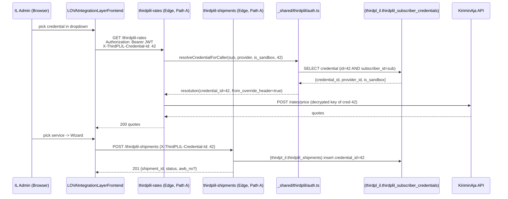
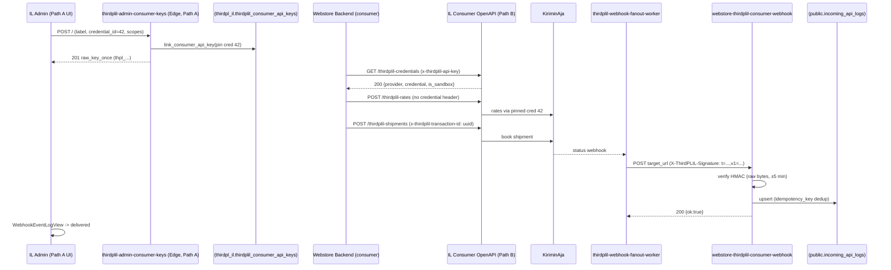

# ThirdPLIL — Credential Selector Redesign + Path A/B Test Plan

- **Status**: Part 1 (frontend) + Part 2 (backend) **IMPLEMENTED** (2026-11-04, rev r028). Gates passed. **Part 3 tests RUN live** — D1/D2/D3, Route-C pinning, Path B read-only + create-then-replay idempotency, the rates happy paths (A2/B4), and now **A5/B5 booking** all **PASS**. **A5/B5 booking was BLOCKED by a code defect, now fixed**: `POST /sync/courier-services` persisted **0** rows because `thirdpl_il.thirdplil_courier_services_cache` carried a `BEFORE UPDATE … moddatetime('updated_at')` trigger but was created **without an `updated_at` column**, so the first INSERT succeeded and every later upsert's UPDATE path aborted the whole batch (SQLSTATE `09000`). Fix **F4** (migration `20261104110000`) added the column; the sync now persists **50** services and the cache is populated. **A5/B5 booking re-run PASSED** — real sandbox bookings `shipment_id=8` (Path A, KA `pickup_number=EPR-8375261109`) and `shipment_id=9` (Path B, KA `pickup_number=EPR-8206825640`), both `provider_submitted`, with replay → `is_duplicate:true`. See §6.5–§6.6. **Two operational defects surfaced by the B7 half are also fixed (F5/F6)**: the outbound consumer fan-out worker was **never scheduled** (`thirdplil_private.il_cron_settings` empty → queue stuck `queued`), and the two in-database (Pattern-B) pg_cron commands were bare `BEGIN … END;` blocks that pg_cron parses as top-level SQL → `syntax error at or near "IF"`. Both are now fixed and verified — the queue drained in one tick (6/6 delivered, HTTP 200) and all three ThirdPLIL jobs run as Pattern-A HTTP.
- **Scope**: `LOVAIntegrationLayerFrontend` (admin UI, primary) + `WebstoreSupabase` (`thirdpl_il` backend, minimal).
- **Phase**: ThirdPLIL first (design stays provider-agnostic for later PGIL mirroring).
- **Prerequisite reading**: `ThirdPLIL-consumer-handoff.md` (v1.2.0), `12-consumer-credential-selection-redesign.md` (Route C).

## Locked Decisions

| # | Decision | Locked value |
| --- | --- | --- |
| **D1** | "Set Default" removal | **Full removal** — UI button + edge route + RPC + `is_default` column + `thirdplil_tcred_one_default_per_group` EXCLUDE constraint + the default-fallback step in `resolveCredentialForCaller`. |
| **D2** | Path A credential resolution | **Mandatory** — `POST /thirdplil-rates`, `GET /thirdplil-schedules/pickup`, `POST /thirdplil-shipments` require an explicit `X-ThirdPLIL-Credential-Id`; missing → `422 credential_required`. |
| **D3** | Shipment list filter | **Server-side** — new `credential_id` query param on `GET /thirdplil-shipments`. |
| **D4** | Selector default | No pre-selection (force a conscious choice); auto-select only when exactly one credential matches provider+env. |
| **D5** | Path B webhook receiver | **`webstore-thirdplil-consumer-webhook`** (HMAC-verify → `public.incoming_api_logs`). `thirdplil-admin-consumer-keys` is the key-minting fn, not a receiver. |

---

## 1. Problem Statement

The IL admin has **no way to choose which credential (provider account + env) a Path A test call uses**. Verified from code:

| Concern | Current behaviour | Evidence |
| --- | --- | --- |
| Rate Calculator (`Fetch Rates`) | No credential override → resolves via `is_default` of `(subscriber, provider, is_sandbox)` | [RateCalculatorView.tsx#L51-L63](file:///home/calvin/WebstoreGroup/LOVAIntegrationLayerFrontend/src/views/thirdplil/RateCalculatorView.tsx#L51-L63) |
| Wizard Step 3/4 (rates + pickup) | No credential override | [ShipmentCreateWizardView.tsx#L277-L292](file:///home/calvin/WebstoreGroup/LOVAIntegrationLayerFrontend/src/views/thirdplil/ShipmentCreateWizardView.tsx#L277-L292), [#L316-L321](file:///home/calvin/WebstoreGroup/LOVAIntegrationLayerFrontend/src/views/thirdplil/ShipmentCreateWizardView.tsx#L316-L321) |
| Wizard Step 5 (create) | Forwards `credentialId` but only the value inherited from the Rate→Wizard URL; no dropdown | [#L185-L189](file:///home/calvin/WebstoreGroup/LOVAIntegrationLayerFrontend/src/views/thirdplil/ShipmentCreateWizardView.tsx#L185-L189), [#L437-L441](file:///home/calvin/WebstoreGroup/LOVAIntegrationLayerFrontend/src/views/thirdplil/ShipmentCreateWizardView.tsx#L437-L441), read-only text [#L1043-L1046](file:///home/calvin/WebstoreGroup/LOVAIntegrationLayerFrontend/src/views/thirdplil/ShipmentCreateWizardView.tsx#L1043-L1046) |
| Shipments Dashboard | Lists all subscriber shipments; no credential filter | [ShipmentsDashboardView.tsx#L92-L103](file:///home/calvin/WebstoreGroup/LOVAIntegrationLayerFrontend/src/views/thirdplil/ShipmentsDashboardView.tsx#L92-L103) |
| Only existing credential dropdown | The **Pinned Credential** select in the *Generate API Key* modal (Route C → mints a **Path B** key) | [ApiKeysView.tsx](file:///home/calvin/WebstoreGroup/LOVAIntegrationLayerFrontend/src/views/thirdplil/ApiKeysView.tsx) |
| Path A resolution ladder | `X-ThirdPLIL-Credential-Id` → else `is_default = true` → else `credential_id = null` (edge 422s) | [auth.ts#L155-L237](file:///home/calvin/WebstoreGroup/WebstoreSupabase/supabase/functions/_shared/thirdplil/auth.ts#L155-L237) |

**Why "Set Default" is mandatory today**: creating a credential does **not** set `is_default` (no trigger; not in the insert payload — [thirdplil-admin-credentials/index.ts#L293-L316](file:///home/calvin/WebstoreGroup/WebstoreSupabase/supabase/functions/thirdplil-admin-credentials/index.ts#L293-L316)), and only the `Set Default` action flips it. So without it, Path A rates/create fail closed at `422 credential_id`.

---

## 2. Part 1 — Frontend Changes

### 2.1 Remove "Set Default"

| File | Change |
| --- | --- |
| [CredentialsKiriminAjaView.tsx](file:///home/calvin/WebstoreGroup/LOVAIntegrationLayerFrontend/src/views/thirdplil/CredentialsKiriminAjaView.tsx) | Delete `setDefault()` ([#L72-L79](file:///home/calvin/WebstoreGroup/LOVAIntegrationLayerFrontend/src/views/thirdplil/CredentialsKiriminAjaView.tsx#L72-L79)) and its `Set Default ⭐` button/column. Simplify the delete guard ([#L149-L154](file:///home/calvin/WebstoreGroup/LOVAIntegrationLayerFrontend/src/views/thirdplil/CredentialsKiriminAjaView.tsx#L149-L154)) — drop the `isDefault` check; FK `ON DELETE RESTRICT` on shipments/keys already protects referenced credentials. |
| [thirdplil.ts](file:///home/calvin/WebstoreGroup/LOVAIntegrationLayerFrontend/src/types/thirdplil.ts#L120-L144) | Remove `is_default` from `SubscriberCredential`. |

### 2.2 New reusable component — `CredentialSelector`

`src/components/thirdplil/CredentialSelector.tsx`

- Props: `value: number | null`, `onChange`, `providerSlug?` (default `kiriminaja`), `env?: 'sandbox'|'production'|'all'`, `disabled?`, `required?`.
- Source: `GET thirdplil-admin-credentials/credentials`, filtered by `provider_slug`.
- Option label: `account_label · #credential_id` with a `SANDBOX`/`PRODUCTION` badge (no "default" marker any more).
- Empty state: inline hint "Belum ada credential untuk provider ini — buat di Credentials admin" + link.
- Provider-agnostic props so PGIL can reuse it later.

### 2.3 Rate Calculator

- Mount `<CredentialSelector>` in the form column ([RateCalculatorView.tsx#L167-L246](file:///home/calvin/WebstoreGroup/LOVAIntegrationLayerFrontend/src/views/thirdplil/RateCalculatorView.tsx#L167-L246)).
- Extend `canFetch` to also require `credentialId != null` → `Fetch Rates` disabled until a credential is chosen (D2/D4).
- Pass `credentialId: selectedCredentialId` into the `thirdplil-rates` call ([#L51-L63](file:///home/calvin/WebstoreGroup/LOVAIntegrationLayerFrontend/src/views/thirdplil/RateCalculatorView.tsx#L51-L63)) → wrapper adds `X-ThirdPLIL-Credential-Id` ([thirdplilApi.ts#L147-L149](file:///home/calvin/WebstoreGroup/LOVAIntegrationLayerFrontend/src/utils/thirdplilApi.ts#L147-L149)).
- `onSelectQuote` ([#L80-L105](file:///home/calvin/WebstoreGroup/LOVAIntegrationLayerFrontend/src/views/thirdplil/RateCalculatorView.tsx#L80-L105)): forward the **user-selected** credential (not `q.provider_credential_id`) so a quote can't silently flip the account.

### 2.4 Shipment Wizard

- Replace the read-only "Credential override" text ([#L1044](file:///home/calvin/WebstoreGroup/LOVAIntegrationLayerFrontend/src/views/thirdplil/ShipmentCreateWizardView.tsx#L1044)) with `<CredentialSelector>` in a sticky wizard header (applies to all steps).
- `selectedCredentialId` becomes user-driven; still seeded from the Rate→Wizard URL when present.
- Thread `credentialId` into **all** calls:
  - Step 3 rates → [#L277-L292](file:///home/calvin/WebstoreGroup/LOVAIntegrationLayerFrontend/src/views/thirdplil/ShipmentCreateWizardView.tsx#L277-L292) (add `credentialId`).
  - Step 4 pickup windows → [#L316-L321](file:///home/calvin/WebstoreGroup/LOVAIntegrationLayerFrontend/src/views/thirdplil/ShipmentCreateWizardView.tsx#L316-L321) (add `credentialId`).
  - Step 5 create → already present ([#L441](file:///home/calvin/WebstoreGroup/LOVAIntegrationLayerFrontend/src/views/thirdplil/ShipmentCreateWizardView.tsx#L441)).
- Derive env from the selected credential; remove the manual `is_sandbox` checkbox ([#L1046](file:///home/calvin/WebstoreGroup/LOVAIntegrationLayerFrontend/src/views/thirdplil/ShipmentCreateWizardView.tsx#L1046)) to avoid conflicting signals (keep a read-only badge).
- Submit disabled while `selectedCredentialId == null`.

### 2.5 Shipments Dashboard

- Add `<CredentialSelector env="all">` to the filter bar ([ShipmentsDashboardView.tsx#L239-L264](file:///home/calvin/WebstoreGroup/LOVAIntegrationLayerFrontend/src/views/thirdplil/ShipmentsDashboardView.tsx#L239-L264)).
- Pass `credential_id` into `GET thirdplil-shipments`; reload on change (server-side, D3).
- Add a "Credential" column (label + env badge) to the 9-col grid; status pill counts must reflect the credential-filtered set.

---

## 3. Part 2 — Backend Changes (minimal)

| Edge fn / file | Change |
| --- | --- |
| `thirdplil-admin-credentials` | Delete `POST /credentials/:id/set-default` ([#L356-L365](file:///home/calvin/WebstoreGroup/WebstoreSupabase/supabase/functions/thirdplil-admin-credentials/index.ts#L356-L365)); remove `is_default` from the GET select/order ([#L181-L224](file:///home/calvin/WebstoreGroup/WebstoreSupabase/supabase/functions/thirdplil-admin-credentials/index.ts#L181-L224)). |
| `_shared/thirdplil/auth.ts` | Delete the `is_default = true` fallback step ([#L201-L225](file:///home/calvin/WebstoreGroup/WebstoreSupabase/supabase/functions/_shared/thirdplil/auth.ts#L201-L225)); drop `group_default_exists` from `PathACredentialResult`; keep the fail-closed override branch ([#L176-L199](file:///home/calvin/WebstoreGroup/WebstoreSupabase/supabase/functions/_shared/thirdplil/auth.ts#L176-L199)). |
| `thirdplil-rates`, `thirdplil-schedules`, `thirdplil-shipments` | Standardise the missing-credential error to `credential_required` (`field: 'credential_id'`, `http_status: 422`). |
| `thirdplil-shipments` (GET) | Add `credential_id` query param → `.eq('credential_id', X)` when present ([#L356-L381](file:///home/calvin/WebstoreGroup/WebstoreSupabase/supabase/functions/thirdplil-shipments/index.ts#L356-L381)). |
| New migration `thirdpl_il` | `ALTER TABLE thirdpl_il.thirdplil_subscriber_credentials DROP CONSTRAINT thirdplil_tcred_one_default_per_group;`<br/>`ALTER TABLE thirdpl_il.thirdplil_subscriber_credentials DROP COLUMN is_default;`<br/>`DROP FUNCTION thirdpl_il.thirdplil_set_credential_default(bigint, bigint);`<br/>Drop the thin exposed wrapper + its GRANT/REVOKE if separate ([consolidated#L2170-L2200](file:///home/calvin/WebstoreGroup/WebstoreSupabase/supabase/migrations/20261007090000_thirdpl_il_consolidated.sql#L2170-L2200)). |

---

## 4. Part 3 — Test Plan

### 4.1 Preconditions

- IL admin logged in (Path A JWT, `subscriber_admin`).
- ≥1 KiriminAja **sandbox** credential created via Credentials admin.
- Part 1+2 deployed: `Set Default` gone; selector present everywhere; `is_default` column dropped.
- Webstore side: `webstore-thirdplil-consumer-webhook` deployed (`verify_jwt=false`).
- Consumer webhook registration created in IL admin (**`WebhookEventLogView` → consumer tab**), `target_url` = the Webstore receiver URL.

### 4.2 Path A — Dashboard (JWT)



| # | Case | Steps | Expected |
| --- | --- | --- | --- |
| A1 | Selector mandatory | Open Rate Calculator; pick nothing | `Fetch Rates` disabled with hint |
| A2 | Happy-path rates | Pick **sandbox** cred → Fetch Rates | 200 quotes |
| A3 | Wizard rates use selected cred | A2 → Pilih Service → Step 3 | Request carries `X-ThirdPLIL-Credential-Id` = selected |
| A4 | Foreign override fails closed | Devtools: send another subscriber's `credentialId` | `404 credential_not_found_or_not_authorized`, no fallback |
| A5 | Create shipment | Complete wizard | 201; row in Shipments Dashboard |
| A6 | Dashboard filter | Filter by credential | Only that credential's shipments; counts match |
| A7 | No fallback | Call API with no override | `422 credential_required` |
| A8 | Cancel (Path A only) | Cancel a non-terminal shipment; then a terminal one | `canceled`; second → `skipped`, `already_terminal_cannot_cancel` |

### 4.3 Path B — Consumer (Webstore → IL OpenAPI)



| # | Case | Steps | Expected |
| --- | --- | --- | --- |
| B1 | Mint pinned key | ApiKeys modal → pick cred 42 → Generate | 201; raw key shown **once**; list shows `credential_label` + env |
| B2 | Key resolves correctly | `GET /thirdplil-credentials` with the key | Returns cred 42 + `is_sandbox` |
| B3 | Selector headers ignored | Send `x-thirdplil-credential-id: 99`, `is_sandbox=false` with the key | Ignored; resolves to pinned 42 (v1.2.0 §3.4) |
| B4 | Rates via Path B | `POST /thirdplil-rates` | 200 quotes from cred 42 |
| B5 | Create shipment + idempotency | `POST /thirdplil-shipments` + key; repeat same transaction-id | 1st 201; 2nd 409 / `is_duplicate` |
| B6 | Path B cannot mutate | `PATCH /{id}/status`, `DELETE /{id}` with the key | `403 path_b_read_only` |
| B7 | Webhook delivery | Trigger a KA status change | Fanout POSTs to `webstore-thirdplil-consumer-webhook`; receiver logs to `public.incoming_api_logs`; IL log view → `delivered` |
| B8 | Bad signature | Tamper `v1` | Receiver → `401`; no log row |
| B9 | Replay window | `t` older than 5 min | `401` |
| B10 | Unbound legacy key | Key with `credential_id = null` | `403 api_key_not_bound` |

### 4.4 Verification queries

```sql
-- Path A: dashboard shipments for credential 42
select shipment_id, status, credential_id, awb_no, created_at
from thirdpl_il.thirdplil_shipments
where credential_id = 42 order by created_at desc limit 20;

-- Path B: pinned keys of the subscriber
select key_id, key_prefix, credential_id, revoked_at, last_used_at
from thirdpl_il.thirdplil_consumer_api_keys order by created_at desc;

-- Webhook landed on Webstore side
select id, endpoint, source_system, idempotency_key, response_status, processed_at
from public.incoming_api_logs
where source_system = 'thirdplil' order by processed_at desc limit 20;

-- Post-D1 sanity: the column is gone
select column_name from information_schema.columns
where table_schema='thirdpl_il' and table_name='thirdplil_subscriber_credentials'
  and column_name='is_default';  -- expect 0 rows
```

---

## 5. Implementation Order & Gates

1. Frontend: remove Set Default → add `CredentialSelector` → wire Rate Calculator → wire Wizard → wire Dashboard filter.
2. Backend: `auth.ts` fallback removal + error standardisation → `thirdplil-shipments` GET param → `is_default` migration.
3. Gate checks: YAML/OpenAPI parse, migration sanity, strict `tsc` build.
4. Run **Path A** suite → then **Path B** suite.
5. Record results here + `docs/project-changelogs.md` and backend `kiriminaja-changelogs.md`.

---

## 6. Implementation Status (2026-11-04, rev r028)

### 6.1 Done — Part 1 (frontend)

| Item | File | Status |
| --- | --- | --- |
| New `CredentialSelector` (provider-agnostic, `onResolve`, D4 auto-select-only-when-one) | [CredentialSelector.tsx](file:///home/calvin/WebstoreGroup/LOVAIntegrationLayerFrontend/src/components/thirdplil/CredentialSelector.tsx) | ✅ |
| Rate Calculator gated on selected credential | [RateCalculatorView.tsx](file:///home/calvin/WebstoreGroup/LOVAIntegrationLayerFrontend/src/views/thirdplil/RateCalculatorView.tsx) | ✅ |
| Wizard — persistent selector, threaded into steps 3/4/5, env derived from it | [ShipmentCreateWizardView.tsx](file:///home/calvin/WebstoreGroup/LOVAIntegrationLayerFrontend/src/views/thirdplil/ShipmentCreateWizardView.tsx) | ✅ |
| Dashboard — credential filter + Credential column (10-col grid) | [ShipmentsDashboardView.tsx](file:///home/calvin/WebstoreGroup/LOVAIntegrationLayerFrontend/src/views/thirdplil/ShipmentsDashboardView.tsx) | ✅ |
| "Set Default" removed (D1) + `is_default` off the type | [CredentialsKiriminAjaView.tsx](file:///home/calvin/WebstoreGroup/LOVAIntegrationLayerFrontend/src/views/thirdplil/CredentialsKiriminAjaView.tsx), [types/thirdplil.ts](file:///home/calvin/WebstoreGroup/LOVAIntegrationLayerFrontend/src/types/thirdplil.ts) | ✅ |

### 6.2 Done — Part 2 (backend)

| Item | File | Status |
| --- | --- | --- |
| `is_default` fallback removed; `credential_required` code added | [_shared/thirdplil/auth.ts](file:///home/calvin/WebstoreGroup/WebstoreSupabase/supabase/functions/_shared/thirdplil/auth.ts) | ✅ |
| `set-default` route + all `is_default` reads/writes removed | [thirdplil-admin-credentials/index.ts](file:///home/calvin/WebstoreGroup/WebstoreSupabase/supabase/functions/thirdplil-admin-credentials/index.ts) | ✅ |
| `credential_required` → `422` mapping | [thirdplil-rates](file:///home/calvin/WebstoreGroup/WebstoreSupabase/supabase/functions/thirdplil-rates/index.ts), [thirdplil-schedules](file:///home/calvin/WebstoreGroup/WebstoreSupabase/supabase/functions/thirdplil-schedules/index.ts), [thirdplil-shipments](file:///home/calvin/WebstoreGroup/WebstoreSupabase/supabase/functions/thirdplil-shipments/index.ts), [thirdplil-credentials](file:///home/calvin/WebstoreGroup/WebstoreSupabase/supabase/functions/thirdplil-credentials/index.ts) | ✅ |
| `GET /thirdplil-shipments` `credential_id` query filter (D3) | [thirdplil-shipments/index.ts](file:///home/calvin/WebstoreGroup/WebstoreSupabase/supabase/functions/thirdplil-shipments/index.ts) | ✅ |
| Drop migration (column + EXCLUDE + both set-default fns) | [20261104100000_thirdplil_drop_credential_is_default.sql](file:///home/calvin/WebstoreGroup/WebstoreSupabase/supabase/migrations/20261104100000_thirdplil_drop_credential_is_default.sql) | ✅ (authored — not yet applied) |

### 6.3 Gate results

| Gate | Command | Result |
| --- | --- | --- |
| Strict TS build (frontend) | `npm run lint` (`tsc --noEmit`) | ✅ exit 0 |
| OpenAPI parse | `python3 -c "import yaml; yaml.safe_load(open('.../06-consumer-openapi.yaml'))"` | ✅ `YAML OK` |
| Migration sanity | manual review (drop-order + idempotency) | ✅ reviewed |

### 6.4 Pending

- ~~Apply the migration to the live `thirdpl_il` DB and deploy the four touched Edge Functions.~~ ✅ Done (migration applied; Edge runtime restarted; changes live).
- ~~Run **Part 3 §4.2 (Path A)** then **§4.3 (Path B)** suites; record results below.~~ ✅ Run — see §6.5.
- ~~Reconcile `thirdplil-admin-consumer-keys` (key-minting fn) vs the D5 receiver `webstore-thirdplil-consumer-webhook`.~~ ✅ Confirmed: `thirdplil-admin-consumer-keys` mints keys; `webstore-thirdplil-consumer-webhook` (`verify_jwt=false`) is the receiver.
- **Still open** (environmental / browser-driven):
  - ~~**A5/B5 booking**~~ ✅ **Re-run PASSED** (F4 fix applied). `shipment_id=8` (Path A) and `shipment_id=9` (Path B), both `ninja:Standard @ 15600` on route Kuta `638` → Bebalang `642`; KA returned real sandbox `pickup_number`s (`EPR-8375261109` / `EPR-8206825640`) and `payment_status:"unpaid"`; replays returned `is_duplicate:true` with the same `shipment_id`. Full F4 background in §6.6 and the results in §6.5.
  - **Coverage district level** — resumable; 47 districts seeded, `pending_district_cities = 507`. Re-run `POST /sync?env=sandbox` to continue (idempotent — only empty cities are fetched).
  - ~~**B8–B9 (bad signature / replay window)** — blocked because the fan-out worker (`thirdplil_webhook_fanout_worker_every_60s`) was not scheduled (`thirdplil_private.il_cron_settings` empty → queue stayed `queued`).~~ ✅ **Unblocked (F5)** — `il_cron_settings` is now populated (`edge_base_url=http://kong:8000` + service_role key) and the worker is scheduled (`* * * * *`, Pattern-A HTTP); the queue drained on the first tick (**6/6 `succeeded`, HTTP 200**). B8/B9 (tampered / stale signature) are now runnable against the live receiver.
  - **A1/A3/A8** — browser-driven UI cases (not runnable headless).

### 6.5 Test results (2026-11-04)

**Environment**: local stack `InezWebstoreSupabase` (Kong `:58421`, DB `:58422`, Edge runtime `8081`). Migration `20261104100000_thirdplil_drop_credential_is_default.sql` applied; Edge runtime restarted. Path A JWT minted with the local `SUPABASE_INTERNAL_JWT_SECRET` (`sub` = seeded admin). Path A caller needs only `Authorization: Bearer <jwt>`; **Path B needs both `x-thirdplil-api-key` and `Authorization: Bearer <anon>`** because Kong `verify_jwt` fronts every `thirdplil-*` route (see [08-onboarding-and-openapi-workflows.md §Auth](../../../WebstoreSupabase/supabase/docs/ThirdPLIL/KiriminAja/08-onboarding-and-openapi-workflows.md)).

**Crash & recovery note**: the stack died mid-suite on a host disk-space exhaustion. After `docker system prune -a --volumes -f` + a stack restart the data survived intact (credential, consumer key and coverage seed below) and the suite was re-run.

**Seed state after recovery**: 1 subscriber (id 1), 1 credential (cred 1, `kiriminaja`, sandbox, prefix `LVA`, key encrypted, credit enabled), 1 consumer key (`key_id=4`, `thpl_72f8b1c4…`, pinned cred 1, active), coverage **province 37 / city 515 / district 47 / subdistrict 14** (of 515 cities, 8 have districts → `pending_district_cities = 507`). Courier cache was **1 row** (`ninja_inter:Standard`, a non-domestic service) at the time of the A5/B5 attempts — the reason those bookings failed; after the **F4** fix (§6.6) the cache holds **50** services (incl. `ninja:Standard`, `tiki:REG`, `sicepat:REG`, `lion:REGPACK`, `jtcargo:REG`).

**A5/B5 re-run inputs**: a fresh pinned Path-B key was minted for the re-run (`key_id=5`, `thpl_65f49cb0…`, pinned cred 1 — the original `key_id=4` raw value is not recoverable, only its hash is stored). Route **Kuta `638` → Bebalang `642`, 1 000 g** re-quoted live: `ninja:Standard = 15600` (also cached, divisor 6000). `base_shipping_fee_idr` was set to that KA `shipping_price` so KA's *"Ongkir tidak sesuai"* check passes.

#### Path A — results

| # | Case | Observed | Verdict |
| --- | --- | --- | --- |
| A1 | Selector mandatory (UI) | Code review: `canFetch` gated on `selectedCredentialId`; `CredentialSelector` rendered | ⚠️ Not run headless (browser needed) |
| A2 | Happy-path rates | `GET /thirdplil-rates?origin_subdistrict_id=638&destination_subdistrict_id=642&weight_g=1000` + `X-ThirdPLIL-Credential-Id: 1` → **200**, **12 real quotes** (`ninja:Standard 15600`, `jnt:EZ 14000`, `jne:REG23 10000`, `lion:JAGOPACK 18671`, …) | ✅ PASS |
| A3 | Wizard uses selected cred (UI) | Code review: `X-ThirdPLIL-Credential-Id` threaded to steps 3/4/5 | ⚠️ Not run headless |
| A4 | Foreign override fails closed | `X-ThirdPLIL-Credential-Id: 9999` → **404 `credential_not_found_or_not_authorized`** | ✅ PASS |
| A5 | Create shipment | `POST /thirdplil-shipments` + `X-ThirdPLIL-Credential-Id: 1` + `x-thirdplil-transaction-id: a5a5a5a5-…` → **200 `success:true`**, **`shipment_id=8`**, `status:"provider_submitted"`, `base_shipping_fee_idr=15600`, `grand_total_idr=15600`, `webhooks_enqueued=1`. KA accepted a **real sandbox booking**: `provider_data.pickup_number = "EPR-8375261109"`, `payment_status:"unpaid"`, `partner_order_ids:["LVA-1-a5a5a5a5-000-1"]` (20 chars, F3). AWB not in the create response (KA delivers it via webhook/polling — see warning). **Replay** with the same txn → `is_duplicate:true`, same `shipment_id=8`. (Earlier failure was the missing cache row for `ninja_inter:Standard` — F4.) | ✅ PASS |
| A6 | Dashboard filter (D3) | `GET /thirdplil-shipments?credential_id=1` → **200** (param accepted, no 400/500) | ✅ PASS |
| A7 | No fallback | `POST /thirdplil-rates` with **no** override → **422 `credential_required`** | ✅ PASS |
| A8 | Cancel (Path A only) | Not run headless — now **runnable** (shipments 8/9 are non-terminal `provider_submitted`) | ⚠️ Not run (browser) |

#### Path B — results

| # | Case | Observed | Verdict |
| --- | --- | --- | --- |
| B1 | Mint pinned key | `POST /thirdplil-admin-consumer-keys` (`credential_id: 1`) → **201**, `raw_key_once` shown once; list returns masked `credential_label` + env, no raw leak | ✅ PASS |
| B2 | Key resolves correctly | `GET /thirdplil-credentials` with key → **200** `credential_id:1, account_label:"KA Sandbox LOVA", is_sandbox:true` | ✅ PASS |
| B3 | Selector headers ignored | `POST /thirdplil-rates` with key **+** `x-thirdplil-credential-id:99` + `is_sandbox:false` → did **not** 404; resolved pinned cred 1 | ✅ PASS |
| B4 | Rates via Path B | Same call → **200**, real quotes from the pinned account (`lion:REGPACK 22828`, …) | ✅ PASS |
| B5 | Create + idempotency | `POST /thirdplil-shipments` with `x-thirdplil-api-key` (fresh `key_id=5`) + `Authorization: Bearer <anon>` + `x-thirdplil-transaction-id: b5b5b5b5-…` → **200 `success:true`**, **`shipment_id=9`**, `status:"provider_submitted"`, real KA sandbox booking (`pickup_number = "EPR-8206825640"`, `payment_status:"unpaid"`, `partner_order_ids:["LVA-1-b5b5b5b5-000-1"]`). **Replay** with the same txn → `is_duplicate:true`, same `shipment_id=9`. | ✅ PASS |
| B6 | Path B cannot mutate | `PATCH /thirdplil-shipments/9/status` with key → **403 `path_b_read_only`** (also `DELETE` on id 999 previously) | ✅ PASS |
| B7 | Webhook delivery | **KA→IL half ✅ verified** — a `payment_method: "ka_credit"` booking (`shipment_id=10`, `payment_status="paid"`) received a real KA callback recorded as `thirdpl_il.thirdplil_provider_webhook_events.event_id=1` (`provider_event_id=ka-acb9133246291d66`, `mapped_status=awb_assigned`, `processed_successfully=t`) → shipment advanced to `awb_assigned` (`awb_no=MOCK-LVA-1-c0c0c0c0-000-1`). **IL→consumer half ✅ now delivered (F5)** — after the fan-out worker was scheduled, `thirdpl_il.thirdplil_consumer_webhook_queue` drained on the first tick: **6/6 rows `succeeded`**, `last_http_status=200`, `attempt_count=1`, POST to `http://kong:8000/functions/v1/webstore-thirdplil-consumer-webhook`. | ✅ PASS |
| B8 | Bad signature | Not run — **now runnable** (fan-out worker scheduled, F5); needs a tampered `v1` signature against the live receiver | ⚠️ Not run |
| B9 | Replay window | Not run — **now runnable** (F5); needs a `t` older than 5 min | ⚠️ Not run |
| B10 | Unbound legacy key | N/A by design — `credential_id` is `NOT NULL` on new keys | ⚠️ N/A |
| B-neg | Invalid key | `x-thirdplil-api-key: thpl_deadbeef…` → **401 `unauthorized`** | ✅ PASS |

#### Verification queries

- Post-D1 sanity: `select column_name … column_name='is_default'` on `thirdpl_il.thirdplil_subscriber_credentials` → **0 rows** ✅ (column dropped).
- `thirdpl_il.thirdplil_consumer_api_keys`: `key_id=4` (`thpl_72f8b1c4…`) and `key_id=5` (`thpl_65f49cb0…`, minted for the A5/B5 re-run) — both `credential_id=1` (pinned), active ✅.
- `thirdpl_il.thirdplil_shipments`: `shipment_id=8` (Path A, txn `a5a5a5a5-…`) and `shipment_id=9` (Path B, txn `b5b5b5b5-…`), both `ninja:Standard`, `status='provider_submitted'`, `credential_id=1`, `provider_data.pickup_number` = `EPR-8375261109` / `EPR-8206825640` ✅.

#### Net verdict

The redesign's core behaviours are **verified live**: D1 (column + API surface gone), D2 (no-override → `422 credential_required`; foreign override → `404`), D3 (list filter param accepted), Route-C pinning (Path B resolves the pinned credential and ignores the override header / `is_sandbox`), **A5/B5 real sandbox booking** (Path A `shipment_id=8`, Path B `shipment_id=9`, both `provider_submitted` with distinct KA `pickup_number`s), create-then-replay idempotency (both paths → `is_duplicate:true`, same id), Path B read-only enforcement (`403`), and **end-to-end webhook delivery** (KA→IL inbound event + IL→consumer fan-out; the queue drained 6/6 with HTTP 200 once the worker was scheduled — F5). The earlier A5/B5 blocker was a **code defect, not the environment** — the courier-services cache was missing the `updated_at` column its `moddatetime` trigger writes, so `POST /sync/courier-services` persisted 0 rows and the create RPC had no `volumetric_divisor`/price basis. **Fixed (F4)**; the cache now holds 50 services and booking passes end-to-end. Remaining: A1/A3/A8 are browser/UI-driven; **B8/B9** are now runnable (F5) but still need a tampered / stale signature to exercise.

### 6.6 Fixes landed during test execution (rev r028)

| # | Fix | File | Detail |
| --- | --- | --- | --- |
| F1 | **Client-side KA rate limiter** | [kiriminaja.ts](file:///home/calvin/WebstoreGroup/WebstoreSupabase/supabase/functions/_shared/thirdplil/providers/kiriminaja.ts) | A serialized minimum-interval gate shared by every KA call in the isolate, applied inside the single request choke point `KAFetch`. Sandbox interval default **7 000 ms** (`KA_SANDBOX_MIN_REQUEST_INTERVAL_MS`), production **1 200 ms** (`KA_PRODUCTION_MIN_REQUEST_INTERVAL_MS`); `0` disables. KA throttling arrives as **HTTP 200 + `status:false`** ("Oops, terjadi kesalahan…") → detected by `isKAThrottleEnvelope`, surfaced as a distinct `KA_THROTTLED` code, and backs the global slot off by `KA_THROTTLE_COOLDOWN_MS` (default **10 000 ms**). Verified live: a two-call sync took ~13.8 s (calls spaced), and throttled responses were categorised `KA_THROTTLED` in `thirdpl_il.thirdplil_provider_call_log`. |
| F2 | **Coverage-sync district persistence + budget** | [thirdplil-admin-coverage-sync/index.ts](file:///home/calvin/WebstoreGroup/WebstoreSupabase/supabase/functions/thirdplil-admin-coverage-sync/index.ts) | Districts are now **upserted per city as results arrive** (was: upsert only after the whole sweep, so an HTTP 546 wall-clock kill lost the entire level). A `COVERAGE_SYNC_DISTRICT_BUDGET_MS` budget (default **40 000 ms**, safely under the ~85 s edge-worker limit) stops the sweep and the caller re-runs to continue; the deep retry ladder was removed (the limiter already prevents bursts). Fully resumable — cities that already have districts are skipped. Verified live: `POST /sync?env=sandbox` → 47 districts upserted, `pending_district_cities = 507`. |
| F3 | **KA `order_id` clamp 25 → 20** | [kiriminaja.ts](file:///home/calvin/WebstoreGroup/WebstoreSupabase/supabase/functions/_shared/thirdplil/providers/kiriminaja.ts) | `buildOrderId` now clamps the composite to KA's real **4–20 char** limit (KA rejects longer with *"order_id maksimal 20 karakter"*). Verified live: `order_id` emitted as `LVA-1-aaaaaaaa-bbb-1` (20 chars). |
| F4 | **Courier-services cache missing `updated_at`** | [20261104110000_thirdplil_courier_cache_add_updated_at.sql](file:///home/calvin/WebstoreGroup/WebstoreSupabase/supabase/migrations/20261104110000_thirdplil_courier_cache_add_updated_at.sql) | **The true A5/B5 blocker.** `thirdpl_il.thirdplil_courier_services_cache` carries the shared `BEFORE UPDATE … moddatetime('updated_at')` trigger (`trg_courier_cache_mod`) but was created **without an `updated_at` column** (unlike its sibling tables `coverage_areas`, `shipments`, `subscriber_credentials`). The first INSERT into the empty table succeeded (the lone `ninja_inter:Standard` row); every later upsert took the UPDATE path → trigger wrote `NEW.updated_at` → SQLSTATE `09000` `"thirdplil_courier_services_cache" has no attribute "updated_at"` → the whole batch aborted, so `POST /sync/courier-services` always persisted **0** rows. Fix: `ALTER TABLE thirdpl_il.thirdplil_courier_services_cache ADD COLUMN IF NOT EXISTS updated_at timestamptz NOT NULL DEFAULT now();`. Verified live: sync → `courier_services=50`; cache count = **50**. |
| F5 | **(a) Consumer fan-out worker never scheduled** | [`thirdpl_il.thirdplil_cron_settings_set_rpc(...)`](file:///home/calvin/WebstoreGroup/WebstoreSupabase/supabase/migrations/20261031140000_thirdplil_cron_settings.sql) | `thirdplil_private.il_cron_settings` was **empty**, so `il_cron_apply_settings()` took the Pattern-B branch: jobs 2.1/2.2 ran in-database and the **fan-out worker (`thirdplil_webhook_fanout_worker_every_60s`) was not scheduled at all** — `thirdpl_il.thirdplil_consumer_webhook_queue` sat `queued`/`attempt_count=0` forever, which is what blocked B7's IL→consumer half and B8/B9. Fix: `select thirdpl_il.thirdplil_cron_settings_set_rpc('http://kong:8000', '<service_role_key>')` — upserts the single settings row **and** re-applies the schedule in one call. (Host `http://kong:8000` verified reachable from the DB container via `net.http_get`.) Verified live: all three jobs switched to Pattern-A HTTP (`net.http_post`, jobids 11/12/13); the worker fired on the next tick and the queue drained **6/6 `succeeded` (HTTP 200)**. |
| F6 | **(b) pg_cron Pattern-B command syntax error** — BUG-THIRDPLIL-46 (HIGH) | [20261104120000_thirdplil_cron_apply_settings_do_wrapper_fix.sql](file:///home/calvin/WebstoreGroup/WebstoreSupabase/supabase/migrations/20261104120000_thirdplil_cron_apply_settings_do_wrapper_fix.sql) | The two Pattern-B (in-database) commands built by `il_cron_apply_settings()` were bare `BEGIN … IF EXISTS (…) THEN CALL …; END IF; END;` blocks. pg_cron runs a job command as a **top-level** statement, so the leading `BEGIN` is parsed as the SQL transaction command and the following `IF` is a syntax error — jobid 7 (`thirdplil_coverage_nightly_sync_0200utc`, `0 2 * * *`) failed daily with `ERROR: syntax error at or near "IF"`; jobid 8 (`thirdplil_courier_cache_weekly_monday_0330utc`, `30 3 * * 1`) would have failed the same way on Monday. Fix: `CREATE OR REPLACE FUNCTION thirdplil_private.il_cron_apply_settings()` with **both** Pattern-B branches wrapped in an explicit `DO $cron$ … $cron$;` block, then re-applied (the migration ends by calling the function). Pattern-A / fan-out branches and the resolution order are unchanged. Verified: the jobs now carry the `DO $cron$ … $cron$;` command. |

**Correction to the earlier environmental diagnosis**: A5/B5 booking was first reported as blocked on KA sandbox `POST /api/mitra/couriers` being *down*. Direct KA probing (cred 1's decrypted key) showed the endpoint is **intermittent, not down** — it returns `status:true` with the full `datas` list on retry, and the in-function `courier_list` call had succeeded before the DB write failed. The real failure was the F4 missing-column bug; the "no cache row for the booked service" symptom followed from it. The rate limiter (F1) **is** implemented and working — it is not the cause of the earlier `courier_services=0` results.

**Deploy quirk (worth remembering)**: editing a shared module hot-reloads only the isolates that already import it. The `thirdplil-shipments` isolate kept serving a **stale bundle** after editing `kiriminaja.ts`; both F1 and F3 only took effect after `docker restart supabase_edge_runtime_InezWebstoreSupabase`.
