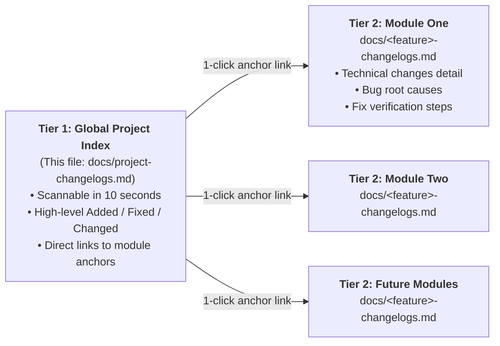

# Project Changelogs — Global Developer Index

This file is the **central high-level index** for changes across the frontend (React SPA) and backend (Supabase Edge Functions + PostgreSQL migrations) codebases.

---

## 📘 Developer Guide: How Changelogs Work in This Project

We use a **Two-Tier Changelog Architecture** designed for speed, clarity, and deep traceability:



### Core Principles

1. **Concise Global Index (This File)**:
   - Contains high-level, scannable bullets per date.
   - Links directly to module sections via **markdown anchors** (e.g., `[module-changelogs.md#YYYY-MM-DDrevN--slug]`).
   - **No fragile line numbers** (`#L123-L145`) — links remain permanently valid regardless of future edits.
2. **Deep Per-Module Changelogs (`docs/<module>-changelogs.md`)**:
   - Each module maintains its own detailed log with full architectural context, database relations, Edge Function payloads, bug analyses, and fix verification steps.

---

## 🗂️ Module Directory Index

| Module | Document | Scope & Key Components |
| :--- | :--- | :--- |
| **ThirdPLIL — KiriminAja Frontend** | [`docs/KiriminAja/kiriminaja-frontend-changelogs.md`](KiriminAja/kiriminaja-frontend-changelogs.md) | 3PL Integration Layer management UI: Credentials page (API keys, sandbox/prod, Test Connection), Rate Calculator, Shipments Dashboard (ServerDataTable + detail drawer), 5-step Create Shipment Wizard, Webhook Event Log (3 sub-tabs: inbound/outbound events, DLQ, consumer registrations). Twin of backend kiriminaja-changelogs.md in WebstoreSupabase. |
| ServerDataTable | [`docs/server-datatable-changelogs.md`](server-datatable-changelogs.md) | Frontend `<ServerDataTable />` component: server pagination, sort, 4 inline filter types, sticky columns, user prefs persistence. |
| Theme Guide View | [`docs/theme-guide-changelogs.md`](theme-guide-changelogs.md) | `/settings/theme-guide` — AGENTS-mandated UI pattern Source of Truth: forms, buttons, banners, tables, status UI, modal header-actions pattern. |
| Build & Tooling (Cross-Cutting) | [`docs/build-tooling-changelogs.md`](build-tooling-changelogs.md) | Vite/TypeScript ambient declarations (e.g. `vite-env.d.ts`); cross-module call-site prop mismatches that don't belong in a single feature log. |

---

## 📝 How to Add a New Changelog Entry

When completing a feature, bug fix, or refactor:

1. **Step 1 — Document in the Module Log**:
   - Open or create `docs/<module>-changelogs.md`.
   - Prepend a new revision block at the top of Section 4 (or first entry):
     ```markdown
     ### YYYY-MM-DD.<revN> — <Short Feature/Fix Title>
     **Scope**: Affected components, hooks, or backend files.
     **Frontend twin changelog** (if paired): `[Frontend/docs/<module>-changelogs.md § YYYY-MM-DD.revN](../Frontend/docs/<module>-changelogs.md#...)`

     #### Changes
     - Detailed explanation of behavioral, architectural, or UI changes.

     #### Found Bugs
     - **BUG-<MOD>-XX**: Root cause, reproduction, and impact. Severity: CRITICAL/HIGH/MEDIUM/LOW.

     #### Fixes
     - **FIX-<MOD>-XX**: Technical resolution, code modifications, and tests.
     ```
2. **Step 2 — Add a Concise Entry to this Global Index**:
   - Add a brief 2–3 line summary under today's date block below, linking to your module's revision anchor.

---

## 📅 Chronological Global Index

### 2026-10-12

#### [ThirdPLIL KiriminAja Frontend (r014 — Credentials view: display webhook URL + wh_secret after credential creation)](KiriminAja/kiriminaja-frontend-changelogs.md#L251-L264)
- **Changed**: `CredentialsKiriminAjaView.tsx` success banner now displays **both** `webhook_url` (full URL to paste into KA Dashboard → Settings → Webhooks) and `raw_key_once` (64-hex `wh_secret`), each with its own Copy button. Previously only `raw_key_once` was shown — user had no way to get the full webhook URL. Added `showWebhookUrlOnce` state; `submitNew` captures both fields from `POST /credentials` response.
- **Fixed**: `raw_key_once` was mislabeled "secret key" — it's actually the webhook `wh_secret` (KA API key is encrypted at rest and never re-displayed).
- Paired backend cross-ref: [kiriminaja-changelogs.md §r014](file:///home/calvin/WebstoreGroup/WebstoreSupabase/supabase/docs/ThirdPLIL/KiriminAja/kiriminaja-changelogs.md#L193-L232).
- Frontend `tsc --noEmit` exit 0 confirmed.

### 2026-10-08

#### [ThirdPLIL KiriminAja Frontend (r013 — NONE code, docs-only pair with backend r013: scope correction saved-address-book rollback)](KiriminAja/kiriminaja-frontend-changelogs.md#L251-L264)
- **Frontend no write, backend-only rev**: User-approved SCOPE BOUNDARY correction. Paired backend rev r013 ROLLS BACK r012 Saved Address Book CRUD endpoints/schemas inside IL (that is Webstore/CRM domain — not integration layer). Kept correct in-scope items: GET /coverage tree hierarchical + CoverageAreaNode stable id. Reverted CreateShipmentRequest → strict 8 inline origin/destination fields required (no expand-by-reference use_saved_* — webstore expands from their OWN address book before POST). Frontend tsc --noEmit still 0.
- Paired backend cross-ref link: [kiriminaja-changelogs.md §r013](file:///home/calvin/WebstoreGroup/WebstoreSupabase/supabase/docs/ThirdPLIL/KiriminAja/kiriminaja-changelogs.md#L193-L220).

#### [ThirdPLIL KiriminAja Frontend (r012 — NONE code, docs-only pair with backend r012: coverage tree + saved address book)](KiriminAja/kiriminaja-frontend-changelogs.md#L251-L264)
- **Frontend no write, backend-only rev**: Paired backend rev r012 extends OpenAPI yaml 2 new groups: GET /coverage/tree (4-level hierarchical provider-agnostic area nodes id=stable bigint FK area_id; code_provider external ids in metadata per provider slug) + Saved Address Book /consumers/{cid}/addresses CRUD + schema SavedAddress (subdistrict_id FK normalized + per-provider_snapshot jsonb + optional use_saved_*_address_id expand on POST /shipments). Frontend tsc --noEmit still 0.
- Paired backend cross-ref link: [kiriminaja-changelogs.md §r012](file:///home/calvin/WebstoreGroup/WebstoreSupabase/supabase/docs/ThirdPLIL/KiriminAja/kiriminaja-changelogs.md#L193-L215).

#### [ThirdPLIL KiriminAja Frontend (r011 — NONE code, docs-only pair with backend r011: ASCII drawing → Mermaid)](KiriminAja/kiriminaja-frontend-changelogs.md#L251-L262)
- **Frontend no write, backend-only rev**: Paired backend rev r011 fixes 08-onboarding §7 confusing ASCII 5-column pipe-art table drawing → replaces with Mermaid `sequenceDiagram` (GitHub/VSCode Preview renders natively). 5 participants / 8 steps / 4 failure alt blocks. TSC still 0 errors.
- Paired backend cross-ref link: [kiriminaja-changelogs.md §r011](file:///home/calvin/WebstoreGroup/WebstoreSupabase/supabase/docs/ThirdPLIL/KiriminAja/kiriminaja-changelogs.md#L193-L211).

#### [ThirdPLIL KiriminAja Frontend (r010 — NONE code, docs-only pair with backend r010 onboarding workflows)](KiriminAja/kiriminaja-frontend-changelogs.md#L251-L264)
- **Frontend no write, backend-only rev**: Paired backend rev r010 delivers NEW document 08-onboarding-and-openapi-workflows.md 7-section start-to-end onboarding (IL ops admin onboarding + Webstore integration). Backend cross-ref link: [kiriminaja-changelogs.md §r010](file:///home/calvin/WebstoreGroup/WebstoreSupabase/supabase/docs/ThirdPLIL/KiriminAja/kiriminaja-changelogs.md#L193-L222). Frontend tsc --noEmit still 0.

#### [ThirdPLIL KiriminAja Frontend (r009 — NONE code, docs-only pair with backend r009 schema move)](KiriminAja/kiriminaja-frontend-changelogs.md#L251-L265)
- **Frontend no write, backend-only rev**: Paired backend rev r009 delivers SCHEMA boundary isolation: ALL 16 tables, 7 enums, 5 RPC funcs moved from `public` → new dedicated schema `thirdpl_il` (avoids webstore public schema pollution). Backend delivered 5 thin `public.<rpc_name>` SQL aliases → forward to real thirdpl_il implementations, zero TS changes. Authenticated/anon/service_role roles default search_path = `"$user", public, thirdpl_il` → `supabase.from('thirdplil_shipments')` still works.
- Paired backend cross-ref: [kiriminaja-changelogs.md §r009](file:///home/calvin/WebstoreGroup/WebstoreSupabase/supabase/docs/ThirdPLIL/KiriminAja/kiriminaja-changelogs.md#L192-L234)
- No regressions expected (frontend tsc --noEmit already 0; no React/TypeScript touched).

#### [ThirdPLIL KiriminAja Frontend (r008 — NONE code, docs-only pair with backend r008 auth handoff doc)](KiriminAja/kiriminaja-frontend-changelogs.md#L251-L264)
- **Frontend no write, docs-only rev**: Paired backend rev r008 delivers single canonical reference **07-auth-tenancy-design.md** (new doc #7 after 06-consumer-openapi.yaml): explains dual PathA+PathB inbound auth, GUC thirdplil.current_subscriber_id equivalence, RLS policies, outbound webhook ThirdPLIL-Signature HMAC-SHA256 signing, only-once 64-hex consumer secret banner, optional X-ThirdPLIL-Credential-Id/Idempotency-Key override headers, PIN Ephemeral Triple Discipline, test vectors, audit/rotation table. PRD §8 Future AI reading order re-ordered: 07-auth-tenancy-design.md now FIRST before 05-tenancy-design.
- Paired backend cross-ref link: [kiriminaja-changelogs.md §r008](file:///home/calvin/WebstoreGroup/WebstoreSupabase/supabase/docs/ThirdPLIL/KiriminAja/kiriminaja-changelogs.md#L193-L208).
- No regressions: tsc --noEmit / npm run lint / VSCode GetDiagnostics all still 0 errors on frontend post r006 baseline (expected: docs-only no code touched).

#### [ThirdPLIL KiriminAja Frontend (r007 — NONE code, docs-only pair with backend r007)](KiriminAja/kiriminaja-frontend-changelogs.md#L251-L264)
- **Frontend no write**: Paired backend rev 007 delivers: 1. OpenAPI 06 adds GET /schedules/pickup dual-auth endpoint docs; 2. DB migration 0008 creates pg_cron nightly 02:00 UTC coverage + weekly Mon courier-services cache refresh jobs; 3. PRD §7 Status Tracker synchronized real-world state.
- No regressions: frontend tsc --noEmit exit 0 confirmed r006 close, unchanged.

#### [ThirdPLIL KiriminAja Frontend (r006 — Wizard 5-step Live + Webhook Log 3-tab Live + Drawer Part 2)](KiriminAja/kiriminaja-frontend-changelogs.md#L251-L278)
- **Changed**: ShipmentCreateWizard 5 steps now fully live: URL pre-fill hook (from Rate Calc select), Step 1 (Origin/Dest 2 SubdistrictLookup), Step 2 (Packages dynamic 20 max, items 50 max add/remove rows), Step 3 (inline Fetch Rates → RateTable compact select), Step 4 (schedules endpoint GET → radio grid pickup windows + cut off badge, fee tone Badge), Step 5 (Review 5-card summary + KA Credit PIN 6-digit password input ephemeral cleared finally unconditionally, onSubmit → POST /shipments → navigate Dashboard with #drawer-open-id hash). WebhookEventLog 3 sub-tabs: Inbound events ServerDataTable Replay → POST admin-webhooks/events/:id/replay; DLQ (5xx attempts 5/5) Replay; Consumer Registrations CRUD + auto 64-hex secret only-once banner + Test Ping signed HMAC. ShipmentDetailDrawer Part 2 full live-hydrate (samplePackages/sampleTimeline removed, useEffect(open) → GET shipments/:id combined `{shipment, history}` payload → state, history sort asc, Pickup driver_name/driver_phone hydrate from pickup_driver_assigned history row note_jsonb). Permissions map added 7 codes (schedule view, ka credit balance, coverage sync, wizard create, webhooks read/replay, consumers write).
- **Fixed**: Type drift in ShipmentHeader — 5 optional `pickup_*` fields missing vs CreateShipmentRequest mirrored on both frontend/backend shared types files. Badge string label guard replaced ReactNode loader pill with inline span. Drawer close clears all state (shipment/history/banner) to prevent stale data on next open without refresh.

### 2026-10-07

#### [ThirdPLIL KiriminAja Frontend (r005 — 4 Views Full Wired + Drawer/Real API)](KiriminAja/kiriminaja-frontend-changelogs.md#L216-L264)
- **Changed**: Credentials list + Add Modal/Set Default/Test Connection/Delete guard (REAL API). Rate Calculator: 2 cascading lookups → Fetch Rates → real RateResultsTable → on-Select jump to Wizard pre-filled. Dashboard: list from real Edge + onRowClick → open ShipmentDetailDrawer (hydrates from API). Wizard Steps 1/2/3 live. Banner piped from callThirdPLILInternalUI result into state.
- **Fixed**: r004 `thirdplilApi.ts` anon key env fallback expanded; `SubdistrictCoverageLookup` default selectedIds prop set (safely handles `undefined` parent).

#### [ThirdPLIL KiriminAja Frontend (r004 — Shared Types + API Wrapper + 3 Shared Components Scaffold)](KiriminAja/kiriminaja-frontend-changelogs.md#L217-L244)
- **Changed**: `src/types/thirdplil.ts` (12 enums + 14 interfaces) + `src/utils/thirdplilApi.ts` typed generic `callThirdPLILInternalUI<T>` wrapper (10-row banner error map, 409 dedup as OK, PIN ephemeral exclude list, auto transaction_id header). 3 Shared Components scaffold stubs in new `components/thirdplil/` folder: SubdistrictCoverageLookup (4-level cascading), RateResultsTable (8-col quote grid), ShipmentDetailDrawer (4 SubTabs header/packages/pickup/timeline). Hook scaffold type exported.
- **Fixed**: (none — scaffolding; real wiring + fetch tests deferred to r005).

#### [ThirdPLIL KiriminAja Frontend (r003 — Phase 1 Wiring)](KiriminAja/kiriminaja-frontend-changelogs.md#L180-L213)
- **Changed**: Phase 1 code written — frontend routing/plumbing is live (5 views accessible by URL + nav). 5 AppView variants appended to src/types.ts, 5 routes registered in APP_ROUTES (settings/credentials → tools/rates → new thirdplil top-level Truck menu for Shipments Dashboard / Create / Webhooks Admin), App.tsx lazy imports + renderView switch 5 cases + navigation tree with permissions, permission-context.tsx VIEW_PERMISSIONS mapping (5 → 12 backend codes), 5 placeholder stub TSX views in new src/views/thirdplil/ folder.
- **Fixed**: (none — wiring/plumbing phase; actual view widgets deferred to next rev).

#### [ThirdPLIL KiriminAja Frontend (2 revs: r001 + r002 — Planning + Specs)](KiriminAja/kiriminaja-frontend-changelogs.md#2026-10-07.r002 -- Frontend PRD Scaffold (3 Deep Specs Docs Completed: Routing → Shared Wrapper → 5 Views)
- **Changed (r001)**: AppView variants (5) + nav group plan + 12 UI invariant patterns §3 locked + PIN ephemeral discipline finalised + §4 thirdplilApi.ts wrapper signature spec. Paired with backend 2026-10-07.r001 (migrations 0001-0006 approved tenancy + RLS seed perms 12 codes).
- **Changed (r002)**: 3 Frontend PRD deep-spec docs written — developer-ready to start coding. 01-frontend-architecture.md (routes, nav groups, permission mapping, breadcrumbs, CTA bars), 02-shared-thirdplilApi-wrapper-hook.md (types file plan, typed generic wrapper, 10-row error→banner grid, PIN ephemeral hook), 03-5-views-deep-spec.md (Credentials cards, Rate Calculator 2-col, Shipments Dashboard+Drawer, 5-step Create Wizard, Webhook Log 3 sub-tabs, 5 shared modals, 7 global rules).
- **Fixed**: (none — planning-only revs; TSX hooks/components implementation deferred to next rev).

### 2026-09-23

#### [ServerDataTable](server-datatable-changelogs.md#2026-09-23.rev1-complete-rewrite-to-match-dss-reference-race-condition-fixes-restored-features)
- **Changed**: Complete rewrite of `src/components/ServerDataTable.tsx` to full DSS parity; split preferences lifecycle into load/apply effects; added 5 type-safe persist functions; restored ResizeObserver-based sticky width measurement, scroll shadows, filter indicator dots, and settings panel bulk actions (Show/Hide/Reset).
- **Fixed**: 9 bugs including race condition on first render with `persistPreferences=true`, sort toggle collision on `id!==sortKey` columns, left-sticky anti-corruption + right-pin cap enforcement, stale/uncaught fetch safety, and Next-button pagination overshoot.

#### [Theme Guide View](theme-guide-changelogs.md#2026-09-23.rev1-theme-guide-brought-to-100-dss-feature-parity)
- **Changed**: `src/views/ThemeGuideView.tsx` expanded from 159 placeholder lines → 507 lines. Added page-level dynamic banner region (4 tones), full interactive form demo (2 cols, spinner, validation, error state references), complete table with actions + modal-open CTA, 2-col status UI grid with 4 semantic banners + badge strip, and a full modal demo showing the header-actions pattern.
- **Fixed**: 8 bugs including the SubTabs prop-name mismatch that broke tab switching, 3 placeholder-only tabs (Form Layout / Table + Actions / Status UI), missing banner and button interactivity, and absent modal-header-actions reference.

#### [Build & Tooling](build-tooling-changelogs.md#2026-09-23.rev1-import.meta.env-type-declarations-restored-cross-project-subtabs-prop-mismatch-repaired)
- **Changed**: Created `src/vite-env.d.ts` with Vite client type reference; corrected one SubTabs call-site prop signature to match the exported component.
- **Fixed**: `tsc --noEmit` errors for every `import.meta.env.VITE_*` access in `src/utils/supabase.ts`, and the silent-failure Theme Guide SubTabs navigation caused by mismatched prop names between projects.
